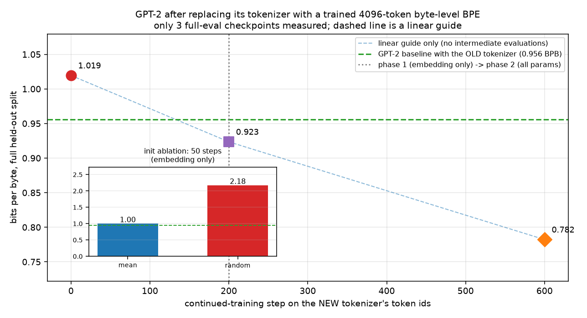

# BPE 分词器：学习路线、从零实现与移植到已有模型

> 版本：2026-11-03
> 适用：已完成本仓库 `transformer_steps/` + `real_llm_lab/`，准备做 CS336 A1，或想系统搞懂 tokenizer 的自学者
> 配套代码：`bpe_lab/`（教学实现 + 测试 + 两个实验）
> 配套材料索引：`docs/bpe/SOURCES.md`
> 一句话：**BPE 本身是一个 80 行能写完的贪心压缩算法；“能不能装到已有模型上”则是另一个问题——答案取决于你说的是“换实现”还是“换词表”。**

---

## 目录

- [0. 先回答你真正问的两件事](#0-先回答你真正问的两件事)
- [1. 直觉：模型看到的不是文本](#1-直觉模型看到的不是文本)
- [2. 字节层：Unicode → UTF-8 → bytes → ids](#2-字节层unicode--utf-8--bytes--ids)
- [3. 算法：BPE 训练到底在做什么](#3-算法bpe-训练到底在做什么)
- [4. 从零实现：把算法写成代码](#4-从零实现把算法写成代码)
- [5. 正确性：用测试逼出所有边界](#5-正确性用测试逼出所有边界)
- [6. 实验：用数字理解 tokenizer](#6-实验用数字理解-tokenizer)
- [7. 移植：把分词器“安”到已有模型上](#7-移植把分词器安到已有模型上)
- [8. 两周学习计划与自测](#8-两周学习计划与自测)
- [9. FAQ：20 个常见错误](#9-faq20-个常见错误)
- [附录 A：材料地图](#附录-a材料地图)
- [附录 B：术语表](#附录-b术语表)
- [附录 C：命令速查](#附录-c命令速查)

---

## 0. 先回答你真正问的两件事

### 0.1 怎么学 BPE 最有效

BPE 的难点**不在算法，在工程细节和“为什么”**。算法本身只有三步：数相邻 pair、选最高频、合并。真正让人卡住的是：

- 为什么必须从字节开始，而不是字符或词？
- `vocab_size` 到底包不包括 256 个字节和 special token？
- 频次并列时为什么取“字典序更大”的 pair，而不是随便选？
- special token 为什么不能参与统计？编码时又该怎么处理重叠？
- 为什么“按顺序重放所有 merge”能编码但很慢？正确又快的做法是什么？
- 为什么朴素实现要几十秒，而 handout 要求 1.5 秒内？瓶颈到底在哪？
- 换一个 tokenizer 之后，模型的 loss 为什么不能直接比较？

所以学习路径应该是**“手算 → 朴素实现 → 测试 → profile → 优化 → 实验”**的闭环，而不是先读论文。下面这条路线按你的时间预算排好了（细节见第 8 章）：

| 阶段 | 时间 | 读什么（本机材料） | 动手 | 验收（可验证） |
| --- | --- | --- | --- | --- |
| 0 直觉 | 1–2 h | CS336 L1 讲稿 `lecture_01.py` 的 `tokenization()` 一节；handout §2.1–2.3 | 在 tiktokenizer 网站上手玩 GPT-2；用 `tokenizer.encode/decode` 做 roundtrip | 能脱稿解释“为什么字/字节/词都不行，BPE 折中了什么” |
| 1 字节层 | 2–3 h | handout §2.1–2.2；本教程第 2 章 | 写 30 行 byte tokenizer；回答 unicode2 的三小问 | `b"你好".decode()`、emoji、`errors="replace"` 都能解释 |
| 2 算法 | 3–4 h | handout §2.4 + 手算例子；第 3 章 | **手算** low/lower/widest/newest 的 12 条 merge；写 30 行 naive 版 | 你的 merge 序列与 handout 完全一致；能解释 tie-break |
| 3 正确性 | 6–8 h | handout §2.6；`tests/test_train_bpe.py`、`tests/test_tokenizer.py` | 预分词、special token、encode/decode、`encode_iterable` | `test_train_bpe` 全绿；自己写的 10 个边界测试全绿 |
| 4 性能 | 1–2 天 | handout §2.5 的优化提示；第 4.10 节 | profile，做反向索引，把 `corpus.en` 训练压到 1.5 s 内 | `test_train_bpe_speed` 通过；记录朴素版/优化版耗时 |
| 5 实验 | 1 天 | handout §2.7；第 6 章 | 压缩比、吞吐、跨 tokenizer、BPB | 4 个实验问题有数字答案 |
| 6 移植 | 1–2 天 | 第 7 章；`bpe_lab/transplant_gpt2.py` | 把新 BPE 装到 GPT-2 上，测 BPB 恢复 | 能解释“为什么掉点、要多少继续训练、何时不值得” |

> **不要做的事**：一上来读 Sennrich 2016 或 BPE 的数学形式化；先玩 `tokenizer.encode`，先手算，先把测试跑绿。论文放到第 6 章之后再读，收益高得多。

### 0.2 BPE 能不能“安”到已有模型上？

这是本教程最容易被含糊回答的问题。先给结论，再给理由和实验（第 7 章）：

| 你说的“安” | 具体含义 | 能不能 | 代价 |
| --- | --- | --- | --- |
| **A. 换实现，不换词表** | 你写了一个 BPE tokenizer，想替换掉模型自带的 tokenizer（比如用自己写的类替代 tiktoken） | ✅ 可以，前提是 **id↔bytes 映射完全一致** | 0，只需要逐 token 对齐验证 |
| **B. 换词表** | 你在自己语料上训练了一个新 BPE，想让预训练模型直接用它 | ⚠️ 技术上可行，但**不是“装上就能用”**：必须改 embedding 和 LM head，并继续预训练 | 掉点 + 继续训练算力；代价主要看**压缩比差多少、词表重叠率多高**（§7.3.5 有实测） |
| **C. 扩展词表** | 保留原 tokenizer，只加 special token 或领域 token | ✅ 常用做法 | 小规模继续训练/微调即可 |
| **D. 只做分析/评测** | 用新 tokenizer 统计压缩比、分析语料，不接模型 | ✅ 完全不需要模型 | 0 |

关键认知只有一句：**tokenizer 不是模型外面可插拔的“预处理组件”，它是模型输入输出接口的一部分。** 词表的每个整数 ID 都对应 embedding 矩阵的一行、LM head 的一列。换词表 = 换模型的输入/输出空间，必然要改权重并重新学习这些 ID 的含义。所以：

- 如果你只是“想用自己写的 tokenizer 喂给模型”，先问：**词表一样吗？** 一样就是情形 A，直接换；不一样就是情形 B/C，需要第 7 章的手术。
- 衡量“换得好不好”，**不能用每 token 的 loss/perplexity**（词表变了，token 数也变了，分母不同），必须用 **bits-per-byte（BPB）**。这是第 6、7 章的核心工具。

---

## 1. 直觉：模型看到的不是文本

### 1.1 三件事，两个方向

语言模型只处理整数序列。Tokenizer 的职责就两个方向：

```
文本 "Hello, 世界"  --encode-->  [15496, 11, 24474, 121, ...]   # 整数序列
整数序列             --decode-->  文本
```

看起来简单，但要同时满足三个约束：

1. **可逆（lossless）**：`decode(encode(s)) == s`。做不到就会悄悄丢信息。
2. **固定词表**：模型参数形状固定，词表必须提前定死，不能推理时冒出新 ID。
3. **压缩**：序列越短，同样的 context window 能装越多内容，训练/推理越省算力。

任何 tokenizer 都是这三者之间的折中。

### 1.2 四条路线，一张表

| 方案 | 词表大小 | 压缩比（英文） | OOV | 主要问题 |
| --- | --- | --- | --- | --- |
| 字符级（Unicode 码点） | ~15 万 | ~1 字符/token（≈1–3 字节/token） | 无（但罕见字符稀疏） | 词表巨大、长尾字符学不好 |
| 字节级 | **256** | 1 字节/token（最差） | 无 | 序列太长，注意力是 O(T²) |
| 词级 | 训练集词表大小，不可控 | 高 | **有**（UNK） | 未登录词、词表爆炸、形态变化 |
| **BPE（字节级）** | **可配置**（1k–200k） | 3–5 字节/token | **无** | 需要训练；有超参和实现复杂度 |

CS336 L1 的原话（`lecture_01.py` 的 `bpe_tokenizer()`）：

> "Intuition: common sequences of bytes are represented by a single token, rare sequences are represented by many tokens."

这就是 BPE 的全部直觉：**高频片段合并成一个 token（省长度），低频片段拆成多个字节（保覆盖）**。它是一个**数据驱动的贪心压缩算法**，不是语言学规则。

### 1.3 用 GPT-2 的真实行为建立手感

GPT-2 的 tokenizer 有三条容易被忽略的行为（`tests/test_tokenizer.py` 里就有断言）：

```python
tokenizer.encode("Hello, how are you?")
# token 串: ["Hello", ",", " how", " are", " you", "?"]
```

1. **空格属于后面的词**：`" how"` 是一个 token，而不是 `" "` + `"how"`。所以 `"hello hello"` 里第一个 `hello` 和第二个 ` hello` 的 token 往往不同。
2. **数字被切成几位一组**：`"123456"` 通常不是 1 个 token，也不是 6 个，而是 2–3 个。
3. **中文/emoji 很吃亏**：GPT-2 词表主要来自英文，一个汉字常被拆成 2–3 个 byte 级 token（3 字节/字）。这就是为什么中文模型要自己训 tokenizer。

> 动手：打开 <https://tiktokenizer.vercel.app/?encoder=gpt2>，输入中英文混合文本，看 token 边界和 ID。这个 10 分钟的体验比读 10 页文档有用。

### 1.4 两个必须掌握的指标

**(1) 压缩比（compression ratio）**：多少字节压成一个 token。

```
compression_ratio = len(text.encode("utf-8")) / len(tokenizer.encode(text))
```

课程笔记里的例子：`"Hello, 🌍! 你好!"` 共 20 字节，GPT-5 的 tokenizer 编成 8 个 token，压缩比 `20/8 = 2.5 bytes/token`（`stanford-cs336-2026-notes-main/lecture-01.md` §5）。GPT-2 在英文上约 **4 bytes/token**；在中文上可能只有 **1–2 bytes/token**。比值越大，同样 context 能装越多原文。

**(2) bits-per-byte（BPB）**：模型对“每个字节”的不确定性，单位 bit。

```
BPB = (Σ -log2 P(token_i | 前文)) / 原文总字节数
    = 每 token 平均 loss(nats) × token 数 / ln(2) / 字节数
```

BPB 是**跨 tokenizer 可比**的，因为它把“token 数”这个分母换成了“字节数”。第 6 章会用一个小例子说明：同一个模型、同一段文本，换 tokenizer 后 per-token loss 可以差很多，但 BPB 才有意义。

### 1.5 五个常见误解

| 误解 | 事实 |
| --- | --- |
| “BPE 是分词（word segmentation）” | BPE 是**子词**压缩，输出不保证是词；`" tokenization"` 和 `" token"`+`"ization"` 都可能 |
| “词表越大越好” | 词表越大序列越短，但 embedding/LM head 参数和 softmax 成本上升，低频 token 学不好；存在最优区间 |
| “tokenizer 不影响模型能力” | 影响很大：同样参数量下，压缩比高的 tokenizer 等效 context 更长、每字节算力更省；中文/代码尤其明显 |
| “空格是分隔符，会被丢掉” | 空格是普通字节，通常并入后一个 token；前导空格有独立 token |
| “BPE 只能处理英文” | 字节级 BPE 对任何 UTF-8 文本都成立，OOV 为 0；只是压缩比因语料而异 |

---

## 2. 字节层：Unicode → UTF-8 → bytes → ids

这一章对应 handout §2.1–2.2 和 `unicode2` 书面题。看似基础，但 80% 的 tokenizer bug 都出在这里。

### 2.1 三个层次

```
字符（character）      "你"、"🌍"、"A"
   │  Unicode 码点（code point，整数）
   ▼
码点                   20320、127757、65
   │  编码（UTF-8）
   ▼
字节序列               b"\xe4\xbd\xa0"、b"\xf0\x9f\x8c\x8d"、b"A"
   │  遍历 bytes
   ▼
整数序列               228, 189, 160, ...
```

- `ord("A") == 65`，`chr(65) == "A"`。
- `"你".encode("utf-8") == b"\xe4\xbd\xa0"`（3 字节）；`"🌍".encode("utf-8")` 是 4 字节。
- `list(b"\xe4\xbd\xa0") == [228, 189, 160]`。

BPE 在**字节层**训练：初始词表就是 256 个单字节，任何文本都能表示，永远不会 OOV。

### 2.2 为什么是 UTF-8，而不是 UTF-16/UTF-32

| 编码 | 英文 `A` | 中文 `你` | emoji `🌍` | 问题 |
| --- | --- | --- | --- | --- |
| UTF-8 | 1 字节 | 3 字节 | 4 字节 | 无（互联网事实标准） |
| UTF-16 | 2 字节 | 2 字节 | 4 字节 | 有 BOM/字节序；ASCII 文本体积翻倍 |
| UTF-32 | 4 字节 | 4 字节 | 4 字节 | 体积最大；大量零字节 |

handout 的 unicode2(a) 问“为什么更倾向在 UTF-8 字节上训练”：核心答案是 **UTF-8 对 ASCII 最省（英文语料占大头）、无字节序问题、是互联网事实标准**；UTF-16/32 会把常见英文文本膨胀 2–4 倍，且 UTF-16 的代理对会让“字节对”失去直观意义。UTF-8 还有一个工程优点：**自同步**（每个字符的首字节高 bit 就说明长度），这对流式解码和错误恢复友好。

### 2.3 经典错误：逐字节 decode

handout 的 `unicode2(b)` 给了这个函数：

```python
def decode_utf8_bytes_to_str_wrong(bytestring: bytes):
    return "".join([bytes([b]).decode("utf-8") for b in bytestring])
```

它错在：**把一个多字节字符的字节序列拆成了独立的单字节去 decode**。UTF-8 里 `b"\xe4"` 不是合法字符串，`.decode("utf-8")` 会直接抛 `UnicodeDecodeError`，而不是“返回错误结果”。正确做法是先把所有字节拼起来，再整体 decode：

```python
b"".join(...).decode("utf-8")            # 严格模式：非法序列抛错
b"".join(...).decode("utf-8", errors="replace")   # 容错模式：非法字节 → U+FFFD
```

`unicode2(b)` 要你给一个“会得到错误结果的输入字节串”，标准答案是任何一个多字节字符的 UTF-8 编码，例如 `"你".encode("utf-8")`。

`unicode2(c)` 要一个“无法解码成任何字符的两字节序列”，例如：

- `b"\xc3\x28"`：首字节声明 2 字节字符，但第二字节 `0x28` 不是 `10xxxxxx` 续字节；
- `b"\x80\x80"`：两个都是续字节，没有首字节。

### 2.4 为什么 tokenizer 解码必须容忍非法字节

token ID 是用户可控的（模型也可能采样出任意 ID），所以 `decode([任意 ids])` 可能拼出非法 UTF-8。handout §2.6.2 明确要求：**用 `errors="replace"` 把坏字节替换成 U+FFFD**。这也是为什么很多 tokenizer 的 `decode` 不是严格可逆的——它保证“不崩溃”，而不是“对任意 ID 都还原”。

### 2.5 本节的三个自测

1. `"🌍".encode("utf-8")` 有几个字节？`list()` 之后是什么？
2. 为什么 `b"\xe4\xbd\xa0".decode("utf-8")` 能成功，而逐字节 decode 不行？
3. 给定 `ids=[50256, 0]`，`decode` 应该返回什么？为什么不能抛异常？

<details>
<summary>答案要点</summary>

1. 4 字节：`[240, 159, 140, 141]`。
2. UTF-8 的 3 字节序列必须整体解码；单字节 `b"\xe4"` 是非法前缀。
3. 返回 `"<|endoftext|>\x00"`（或对应 special token 字符串 + 空字节），非法部分用 U+FFFD；因为用户可能传任意 ID，接口必须容错。

</details>

---

## 3. 算法：BPE 训练到底在做什么

### 3.1 三个动作，一句话

```
① 词表初始化   256 个单字节 + 你传入的 special tokens
② 预分词       用正则把语料切成片段，统计「片段 → 出现次数」
③ 循环合并     数相邻 pair（只数片段内部）→ 选最高频 → 合成新 token
               直到词表满 vocab_size
```

训练产物是两个东西：

- `vocab: dict[int, bytes]`：每个 token ID 对应的原始字节；
- `merges: list[tuple[bytes, bytes]]`：按创建顺序排列的合并记录，`(左 token 字节, 右 token 字节)`。

**注意 `merges` 里存的是 bytes 而不是 ID**。因为 ID 依赖词表布局（special token 放哪、按什么顺序分配），而 bytes 是稳定的。

### 3.2 手算一遍 handout 的例子（最重要的一节）

语料（handout 的 `bpe_example`）：

```
low low low low low
lower lower widest widest widest
newest newest newest newest newest newest
```

为了聚焦合并过程，这里假设预分词就是**按空白切**。于是：

| 预分词片段 | 频次 |
| --- | --- |
| `low` | 5 |
| `lower` | 2 |
| `widest` | 3 |
| `newest` | 6 |

初始词表：256 个字节 + special token `<|endoftext|>`（ID 256）。第一个 merge 产物的 ID 是 257。

**第 1 轮**，数所有相邻 pair（频次要乘以片段频次）：

| pair | 计数 | | pair | 计数 |
| --- | --- | --- | --- | --- |
| `(e,s)` | 9 | | `(n,e)` | 6 |
| `(s,t)` | **9** | | `(e,w)` | 6 |
| `(w,e)` | 8 | | `(d,e)` | 3 |
| `(l,o)` | 7 | | `(i,d)` | 3 |
| `(o,w)` | 7 | | `(w,i)` | 3 |
| | | | `(e,r)` | 2 |

`(e,s)` 和 `(s,t)` 并列 9。tie-break 规则是**取字典序更大的 pair**：`(b"s", b"t") > (b"e", b"s")`，所以选 `(s,t)`。合并后：

```
widest → w i d e (st)     ×3
newest → n e w e (st)     ×6
low    → l o w            ×5
lower  → l o w e r        ×2
```

**第 2 轮**：`(e,st)` 计数 9，最高；合并成 `est`。此时 `widest → w i d (est)`，`newest → n e w (est)`。

**第 3 轮**：`(l,o)` 和 `(o,w)` 并列 7；字典序更大的是 `(o,w)`（首元素 `b"o" > b"l"`）。合并成 `ow`。

**第 4 轮**：`(l,ow)` 计数 7（来自 low×5 + lower×2）；合并成 `low`。

**第 5 轮**：`(e,w)`、`(n,e)`、`(w,est)` 并列 6。按首元素比较：`b"w" > b"n" > b"e"`，选 `(w,est)`，得到 `west`。

**第 6 轮**：`(n,e)` 与 `(e,west)` 并列 6；`b"n" > b"e"`，选 `(n,e)`，得到 `ne`。

此时 6 条 merge 的词表新增：`st, est, ow, low, west, ne`。`newest` 被切成 `[ne, west]` —— 与 handout 的结论一致。

继续下去，完整的 12 条 merge 是（**这就是 A1 测试会逐条比对的东西**）：

```python
['s t', 'e st', 'o w', 'l ow', 'w est', 'n e',
 'ne west', 'w i', 'wi d', 'wid est', 'low e', 'lowe r']
```

> 想自己验证？`bpe_lab/test_toy_bpe.py` 里有这个例子的精确断言；也可以拿一张纸手推前 6 轮。**手推一遍是理解 tie-break 和“片段内计数”的最快方式**，不要跳过。

### 3.3 `vocab_size` 到底怎么算

handout 写得很明确：

> `vocab_size`: a positive integer that defines the maximum final vocabulary size (including the initial byte vocabulary, vocabulary items produced from merging, and any special tokens).

所以：

```
merge 次数 = vocab_size - 256 - len(special_tokens)
```

| 场景 | vocab_size | special tokens | merge 数 |
| --- | --- | --- | --- |
| handout 小例子（6 merges） | 263 | 1 | 6 |
| A1 `test_train_bpe` | 500 | 1 | 243 |
| TinyStories 10K | 10,000 | 1 | 9,743 |
| OWT 32K | 32,000 | 1 | 31,743 |
| 本教程移植实验 | 4,096 | 1 | 3,839 |

如果 `vocab_size < 256 + len(special_tokens)`，直接报错而不是硬跑。

### 3.4 tie-break：为什么必须“字典序更大”

并列时随便选会导致**不可复现**，而 A1 的 `test_train_bpe` 会逐条比对 merges，所以规则必须固定。handout 用的是：

```
同频时，选 (token1, token2) 字典序更大的那个
```

注意两个细节：

1. **比较的是 token 的 bytes，不是 ID**。ID 是按创建顺序分配的，`id=300` 的 token 不一定比 `id=257` 的“大”。
2. Python 的 `bytes` 比较是逐字节比较，前缀更短者更小：`b"BA" > b"B" > b"A"`。

正确写法：

```python
# stats: dict[(id_a, id_b), int]
pair = max(stats, key=lambda p: (stats[p], vocab[p[0]], vocab[p[1]]))
```

handout 的例子：`("A","B")`, `("A","C")`, `("B","ZZ")`, `("BA","A")` 同频，选 `("BA","A")`，因为首元素 `b"BA" > b"B" > b"A"`（`b"ZZ"` 首元素是 `b"B"`，比 `b"BA"` 小）。

> 为什么是“更大”而不是“更小”？没有深层原因，纯粹是 handout 为了确定性选定的规则。不同实现（tiktoken、HF tokenizers）可能有自己的 tie-break；**跟测试对齐时以 handout 为准**。

### 3.5 special token：训练时是硬边界，编码时是整体

special token（如 `<|endoftext|>`）有两个身份：

**训练阶段**：

- 它被加入词表（ID 排在 256 之后、merge 产物之前）；
- 它把语料切成互不相通的段：**绝不能跨 special token 数 pair**，否则会把 `[Doc 1]` 的结尾和 `[Doc 2]` 的开头粘成一个 token；
- 它自己**不参与** pair 统计（不算作任何 pair 的左右元素）。

实现上：先按 special token 切分语料，再对每段做预分词和计数。切分时：

```python
import re
pattern = "|".join(re.escape(s) for s in sorted(special_tokens, key=len, reverse=True))
segments = re.split(pattern, text)
# 奇数下标是 special token 本身
```

**编码阶段**：

- 同样按 special token 切分，special 部分直接映射成它的 ID，绝不经过 BPE；
- 如果传入的 special token 不在 vocab 里，按 handout 要求**追加到词表末尾**（新 ID）；
- 多个 special token 互为前缀时（如 `<|endoftext|>` 与 `<|endoftext|><|endoftext|>`），必须**按长度降序匹配**，否则长 token 永远匹配不到。`test_overlapping_special_tokens` 就是考这个。

一个常见 bug：训练时忘了传 special token，结果 `<|endoftext|>` 被正常 BPE 合并成 `["<|", "endof", "text", "|>"]` 之类的碎片。此时即使编码时把它当 special，训练出的 merges 也已经污染了。

### 3.6 训练伪代码与数据结构

```python
def train_bpe(corpus, vocab_size, special_tokens):
    vocab = {i: bytes([i]) for i in range(256)}
    for i, s in enumerate(special_tokens):
        vocab[256 + i] = s.encode("utf-8")

    # 1) 预分词 + 计数：只保留 unique 片段，值是该片段出现次数
    pretokens = Counter(pretokenize(corpus))        # tuple[bytes, ...] -> freq

    # 2) 初始化 pair 统计（按频次加权）
    stats = Counter()
    pair_to_pretokens = defaultdict(set)            # (id_a, id_b) -> {片段 key}
    for seq, freq in pretokens.items():
        for a, b in zip(seq, seq[1:]):
            stats[(a, b)] += freq
            pair_to_pretokens[(a, b)].add(seq)

    merges = []
    while len(vocab) < vocab_size:
        # 3) 选最高频 pair（tie-break：bytes 字典序更大）
        pair = max(stats, key=lambda p: (stats[p], vocab[p[0]], vocab[p[1]]))
        new_id = len(vocab)
        merges.append((vocab[pair[0]], vocab[pair[1]]))
        vocab[new_id] = vocab[pair[0]] + vocab[pair[1]]

        # 4) 只更新“含有该 pair 的片段”，并删除/新增受影响的 pair 计数
        for key in list(pair_to_pretokens[pair]):
            new_key = replace_pair(key, pair, new_id)
            update_stats_and_index(...)             # 见 4.4 的实现说明
        del stats[pair]

    return vocab, merges
```

关键数据结构：

| 结构 | 类型 | 作用 |
| --- | --- | --- |
| `vocab` | `dict[int, bytes]` | ID → 字节 |
| `pretokens` | `Counter[tuple[bytes,...]]` | 片段 → 频次（只存 unique，省内存） |
| `stats` | `dict[(int,int), int]` | 相邻 pair → 加权频次 |
| `pair_to_pretokens` | `dict[(int,int), set[tuple]]` | 反向索引：哪些片段含有这个 pair |
| `merges` | `list[(bytes,bytes)]` | 输出，按创建顺序 |

### 3.7 复杂度：为什么朴素版慢，慢在哪

设：

- `B`：语料字节数（例如 5 MB = 5×10⁶）；
- `U`：unique 预分词片段数（英文语料约几万）；
- `L`：片段平均 token 长度（约 3–8）；
- `M`：merge 次数（TinyStories 10K 约 9.7k）。

| 实现 | 每轮成本 | 总成本 | 5MB / 10K 量级 |
| --- | --- | --- | --- |
| 朴素：每轮重新数所有片段 | `O(U·L)` | `O(M·U·L)` | ~10¹⁰ 次操作，几十秒到几分钟 |
| 预分词 + 每轮重数 unique 片段 | `O(U·L)` | 同上 | 同上（预分词只省掉了 `B` 的重复扫描） |
| **增量更新** | 只更新含被合并 pair 的片段 | 近似 `O(总 pair 出现次数 × 轮数影响)` | 通常快 10–100× |
| 再加堆选 max | 选 max 从 `O(P)` 降到 `O(log P)` | 进一步提速 | 选 max 常是第二大瓶颈 |

handout 给的实测参照（写在他的 `test_train_bpe_speed` docstring 里）：

- 参考实现：`corpus.en` 上 500 词表 **0.38 秒**；
- “玩具实现”：约 **3 秒**；
- 测试上限：**1.5 秒**。

TinyStories 10K 的资源要求：≤ 30 分钟、≤ 30 GB RAM；handout 提示用多进程预分词可以 **< 2 分钟**。OWT 32K：≤ 12 小时、≤ 100 GB RAM —— 内存主要花在 `pair_to_pretokens` 这种反向索引上。

**三个瓶颈，按出现顺序**：

1. **预分词**（正则 + 逐行读）：大语料上是大头；用 `re.finditer` 避免把整篇切成 list；多进程按 special token 边界分块（`pretokenization_example.py` 的 `find_chunk_boundaries`）。
2. **每轮重扫所有片段**：用反向索引，只碰受影响的片段。
3. **每轮 `max(stats)` 线性扫描**：pair 数可达几十万，9.7k 轮就是几十亿次比较；用惰性堆（push `(-count, pair)`，弹出时校验 count 是否过期）或分桶。

### 3.8 编码：为什么不能“按顺序重放所有 merge”

最直觉的编码实现是：

```python
ids = list(text.encode("utf-8"))
for left, right in merges:            # 按创建顺序
    ids = replace_all(ids, (left, right))
```

它**是对的**，但复杂度是 `O(merge 数 × 序列长度)`：GPT-2 有 5 万条 merge，编码 1KB 文本要重扫 5 万次。这就是为什么需要“只处理相关的 merge”。

正确又快的做法是**按 rank 贪心**：

```python
ranks = {pair: i for i, pair in enumerate(merges)}    # pair -> 创建顺序

def encode_pretoken(ids):
    while len(ids) > 1:
        best = None
        for i in range(len(ids) - 1):
            r = ranks.get((ids[i], ids[i+1]))
            if r is not None and (best is None or r < best[0]):
                best = (r, i)
        if best is None:
            break
        r, i = best
        ids = ids[:i] + [new_id_of[merges[r]]] + ids[i+2:]
    return ids
```

为什么等价？因为**合并只会产生“更晚”的新 pair**（新 token 刚被创建，不可能出现在更早的 merge 里），所以“每次合并当前 rank 最小的 pair”与“按 rank 顺序逐条应用 merge”结果相同。

编码还要处理三件事：

1. **只在预分词片段内部合并**，不能跨片段；
2. **special token** 先切出来，整体映射成 ID；
3. **缓存**：同一个预分词片段（如 `" the"`）会反复出现，把 `bytes → tuple[int]` 缓存起来，实际吞吐能提高几倍到几十倍。

用 handout 的例子走一遍（vocab/merges 见 §2.6.1）：

```
输入: "the cat ate"
预分词: ["the", " cat", " ate"]

"the":  [t,h,e] → 找到 (t,h) rank=0 → [th,e] → 找到 (th,e) rank=3 → [the] → 无可用 pair
" cat": [ ,c,a,t] → (,c) rank=1 → [ c,a,t] → 剩下的 (' c','a')、('a','t') 都不是 merge → 停
" ate": [ ,a,t,e] → (,a) rank=2 → [ a,t,e] → ( a,t) rank=4 → [ at,e] → 无

输出: [9, 7, 1, 5, 10, 3]
```

### 3.9 解码

```python
def decode(ids):
    data = b"".join(vocab[i] for i in ids)     # 缺失 ID 会 KeyError，接口上应先校验
    return data.decode("utf-8", errors="replace")
```

只有两个坑：

- 词表里的 token 可能是**半个 UTF-8 字符**（字节级 BPE 正常现象），必须拼接后再 decode；
- 非法 ID 序列要容错，用 `errors="replace"`。

### 3.10 BPE 与其他子词方法

| 方法 | 代表模型 | 训练目标 | 编码方式 | 特点 |
| --- | --- | --- | --- | --- |
| **BPE** | GPT-2/3/4、Llama-3、Qwen | 贪心合并最高频 pair | 按 merge rank 合并 | 简单、可复现、字节级无 OOV |
| WordPiece | BERT | 最大化语言模型似然（近似） | 贪心最长匹配，`##` 表示词内 | 词表固定，UNK 仍存在 |
| Unigram | T5、ALBERT | 概率模型 + EM 剪枝 | Viterbi 最大概率切分 | 天然多切分、可采样 |
| SentencePiece | Llama-1/2、T5 | BPE 或 Unigram + 归一化 | 以 `▁` 表示空格 | 语言无关、可直接吃原始文本 |
| 字节级（无 tokenizer） | ByT5、BLT | — | 直接 bytes | 序列长、算力贵，是另一条路线 |

Llama-1/2 用的是 SentencePiece 的 BPE（32K），Llama-3 换成了 tiktoken 风格的字节级 BPE（128K），Qwen 系列约 15 万词表。**tokenizer 换代通常伴随模型换代**，因为词表一变，权重就得重训或做移植——这正是第 7 章的主题。

---

## 4. 从零实现：把算法写成代码

> 本节是“实现路线图 + 关键代码骨架”，完整可运行版本在 [`bpe_lab/toy_bpe.py`](bpe_lab/toy_bpe.py)。建议你先按本章自己写一遍，再对照。
>
> **CS336 学术诚信提醒**：如果你正在修 CS336 学分，A1 的 tokenizer 必须自己写。`bpe_lab/` 的 API 刻意与 A1 的 `tests/adapters.py` 不同，代码也更慢、更“教学化”；请把它当参考答案来读，读完合上重写，不要直接复制提交。

### 4.1 文件与 API

```python
PAT = r"""'(?:[sdmt]|ll|ve|re)| ?\p{L}+| ?\p{N}+| ?[^\s\p{L}\p{N}]+|\s+(?!\S)|\s+"""

def gpt2_pretokenize(text: str) -> list[str]: ...
def whitespace_pretokenize(text: str) -> list[str]: ...      # 只为复现 handout 手算例子

def train_bpe(corpus: str, vocab_size: int, special_tokens: list[str] | None = None,
              *, pretokenizer=gpt2_pretokenize, naive=False, verbose=False
              ) -> tuple[dict[int, bytes], list[tuple[bytes, bytes]]]: ...

class BPETokenizer:
    def __init__(self, vocab, merges, special_tokens=None, pretokenizer=gpt2_pretokenize): ...
    def encode(self, text: str) -> list[int]: ...
    def encode_iterable(self, it) -> Iterator[int]: ...
    def decode(self, ids) -> str: ...
    def save(self, dirpath): ...
    @classmethod
    def from_files(cls, vocab_path, merges_path, special_tokens=None): ...
```

`pretokenizer` 参数是为了教学：handout 的手算例子用“按空白切”，生产实现用 GPT-2 正则。把它做成可注入，测试才能精确复现 handout 的 merge 序列。

### 4.2 预分词：GPT-2 正则逐段解释

```python
PAT = r"""'(?:[sdmt]|ll|ve|re)| ?\p{L}+| ?\p{N}+| ?[^\s\p{L}\p{N}]+|\s+(?!\S)|\s+"""
```

| 分支 | 匹配什么 | 例子 |
| --- | --- | --- |
| `'(?:[sdmt]|ll|ve|re)` | 英文缩写后缀 | `'s` `'ll` `'ve` `'re`（只匹配小写） |
| ` ?\p{L}+` | 可选一个空格 + 连续字母 | `Hello`、` world` |
| ` ?\p{N}+` | 可选一个空格 + 连续数字 | ` 123` |
| ` ?[^\s\p{L}\p{N}]+` | 可选一个空格 + 连续标点/符号 | `,`、`?!`、`...` |
| `\s+(?!\S)` | 后面不再接非空白的空白（行尾空白） | 末尾的 `\n` |
| `\s+` | 其它连续空白 | 缩进、空行 |

用 `regex` 包（不是标准库 `re`），因为需要 `\p{L}`/`\p{N}`：

```python
import regex
regex.findall(PAT, "some text that i'll pre-tokenize")
# ['some', ' text', ' that', ' i', "'ll", ' pre', '-', 'tokenize']
```

三个实现要点：

1. **用 `finditer` 而不是 `findall`**：`findall` 会把整篇文本的片段全存进内存；`finditer` 是一个个吐。
2. **special token 先切再预分词**：`re.split` 的捕获组保留分隔符，奇数下标就是 special。
3. **不要跨片段配对**：计数时对每个片段单独 `zip(seq, seq[1:])`。

### 4.3 计数：只数 unique 片段

```python
from collections import Counter

def count_pretokens(corpus: str, specials: list[str]) -> Counter:
    counts = Counter()
    for segment in split_on_specials(corpus, specials):
        for m in regex.finditer(PAT, segment):
            counts[tuple(m.group().encode("utf-8"))] += 1
    return counts
```

为什么按“片段”计数而不是按全文：同一个词 `" the"` 出现 10 万次，只需记录 `(b" ", b"t", b"h", b"e") -> 100000`，之后每轮用频次加权，不用重扫原文。这是 handout §2.4 说的“increment by 10 instead of looking through the corpus”。

### 4.4 合并循环：增量更新的核心

核心不变量：`stats` 必须等于“所有片段按当前 token 序列重新数一遍”的结果。每次合并 `(a,b) → c`，只有三类 pair 会变：

1. 被删除的 `(a,b)`；
2. 合并点左边的新 pair `(x, c)`（如果左边还有 token `x`）；
3. 合并点右边的新 pair `(c, y)`（如果右边还有 token `y`）。

```python
def replace_pair(seq, pair, new_id):
    out, i = [], 0
    while i < len(seq):
        if i + 1 < len(seq) and seq[i] == pair[0] and seq[i+1] == pair[1]:
            out.append(new_id); i += 2
        else:
            out.append(seq[i]); i += 1
    return tuple(out)

def apply_merge(pretokens, stats, index, pair, new_id):
    for old_key in list(index[pair]):
        freq = pretokens.pop(old_key)
        new_key = replace_pair(old_key, pair, new_id)
        pretokens[new_key] = pretokens.get(new_key, 0) + freq
        # 先删 old_key 贡献的所有 pair 计数（或只删受影响的），再加 new_key 的
        for p in pairs_of(old_key):
            stats[p] -= freq
            if stats[p] == 0: del stats[p]
            index[p].discard(old_key)
        for p in pairs_of(new_key):
            stats[p] += freq
            index[p].add(new_key)
```

> 真实实现里“先全删再加”会把成本放大 3–4 倍；更好的做法是只修变化的那几个 pair（`(a,b)` 以及合并点两侧的 pair），并维护每个片段的 token 序列缓存。`bpe_lab/toy_bpe.py` 用的是“只碰受影响片段 + 只改变化 pair”的版本，代码里有注释对照。

另外两个细节：

- **键的类型**：用 `int`（token ID）做 pair 的键比 `bytes` 快，也省内存；但 tie-break 时必须查 `vocab` 拿 bytes 比较。
- **相同片段合并**：合并后可能出现两个不同片段变成同一个序列（如 `low` 和 `l ow`），要把频次相加。

### 4.5 编码：rank 贪心 + 缓存

```python
class BPETokenizer:
    def __init__(self, vocab, merges, special_tokens=None):
        self.vocab = dict(vocab)
        self.ranks = {pair: i for i, pair in enumerate(merges)}
        self.merge_to_id = {pair: 256 + len(special_tokens or []) + i
                            for i, pair in enumerate(merges)}  # 注意 ID 布局
        self.special_to_id = {}
        for s in special_tokens or []:
            b = s.encode("utf-8")
            if b not in self.vocab.values():
                self.vocab[len(self.vocab)] = b
            self.special_to_id[s] = next(i for i, v in self.vocab.items() if v == b)
        self.cache = {}
```

`self.merge_to_id` 的公式依赖“词表布局”：256 字节 + specials 在前，merge 产物从 `256 + len(specials)` 开始。**如果你的词表是从文件加载的，不要用这个公式，直接从 `vocab` 反查**（这是从零实现和 `from_files` 最容易对不上的地方）。

```python
def encode(self, text: str) -> list[int]:
    ids = []
    for segment, is_special in split_keep_specials(text, self.special_to_id):
        if is_special:
            ids.append(self.special_to_id[segment])
        else:
            for m in regex.finditer(PAT, segment):
                ids.extend(self._encode_pretoken(m.group().encode("utf-8")))
    return ids

def _encode_pretoken(self, b: bytes) -> tuple[int, ...]:
    if b in self.cache:
        return self.cache[b]
    ids = list(b)
    while len(ids) > 1:
        best_rank, best_i = None, -1
        for i in range(len(ids) - 1):
            r = self.ranks.get((self.vocab[ids[i]], self.vocab[ids[i+1]]))
            ...
    self.cache[b] = tuple(ids)
    return self.cache[b]
```

注意：`ranks` 的键应该是 **bytes 对**还是 **ID 对**？两种都行，但必须一致：merge 列表给的是 bytes，词表给的是 ID。常见做法是维护 `bytes_pair -> rank`，编码时用 `vocab[id]` 查；或者预先建 `id_pair -> rank`。后者在 `from_files` 时更自然，因为可以直接从 vocab 反查每个 token 的 ID。

**缓存**是吞吐的关键：`test_tokenizer.py` 里有 5MB 文本的流式测试，没有缓存会慢一个数量级。

### 4.6 解码与特殊 token

```python
def decode(self, ids):
    return b"".join(self.vocab[i] for i in ids).decode("utf-8", errors="replace")
```

special token 的 bytes 本来就在 `vocab` 里，所以解码时会原样还原成 `<|endoftext|>`。这也意味着 `decode(encode(text_with_special)) == text_with_special`。

### 4.7 序列化：为什么需要 GPT-2 的 byte↔unicode 映射

BPE 词表里的 token 是**任意字节**，很多不是合法 UTF-8（例如 `b"\xe4\xbd"` 是半个汉字）。直接写进 JSON 会报错。GPT-2 的解法是做一层**保序双射**：把 256 个字节映射到 256 个可打印 Unicode 字符（如空格 → `Ġ`），这样每个 token 都能写成合法字符串。

`tests/common.py` 里的 `gpt2_bytes_to_unicode()` 就是这段代码；`tests/test_tokenizer.py` 加载 fixture 时用它的逆映射还原 bytes。两种常见格式：

```text
# vocab.json（GPT-2 风格：remapped token string -> id）
{"!": 0, "\"": 1, ..., "Ġthe": 262, ...}

# merges.txt（每行两个 remapped token）
Ġ t
Ġt h
...
```

> 也可以自己用 hex（`"e4bd"`）或 base64 序列化，只要读写一致即可。A1 的测试只要求你的 `from_files` 能读你 `train_bpe` 写出的格式；但如果你想直接加载 GPT-2 的 `vocab.json`/`merges.txt`，就必须实现这层映射。

### 4.8 跑起来：demo 与预期输出

```bash
cd /Users/yunni/Projects/cs336-prep-code
.venv/bin/python bpe_lab/demo_train.py                    # 默认 ~300KB 子集、vocab 1000
.venv/bin/python bpe_lab/demo_train.py --compare-naive    # 顺带对比 naive 实现
.venv/bin/python bpe_lab/test_toy_bpe.py                  # 全部测试，无需 pytest
```

本机实测（Apple M5，单进程；见 `bpe_lab/results/toy_demo.json`）：

| 指标 | 数值 |
| --- | --- |
| 语料 | 训练 299,754 字符 / 299,896 字节；留出 20,248 字节 |
| vocab / merges | 1000 / 743 |
| 训练耗时 | **0.124 s**（峰值内存 53 MB） |
| 最长 token（排除 special） | `b' unexpected'`（11 字节） |
| 留出集压缩比 | **3.206 bytes/token**（0.3119 tokens/byte） |
| encode 吞吐（冷缓存） | **11.8 MB/s**；`encode_iterable` 11.1 MB/s |
| naive vs fast | 0.454 s vs 0.031 s（14.5×，743 merges 同结果） |

前 5 条 merge 是 `he`、`" t"`、`" a"`、`" s"`、`" w"`，第 6 条 `" t" + "he" → " the"`。**带前导空格的 token 出现得非常早**——这是 GPT-2 预分词（` ?\p{L}+` 把空格并进词）的直接结果；也解释了为什么 GPT-2 词表里大量 token 以 `Ġ`（空格）开头。

注意：这份小语料只有 2,923 个 unique pre-token，缓存命中率极高，吞吐数字偏高；在真实语料上会低不少。`--compare-naive` 只在小切片上跑 naive 路径。

### 4.9 你必须自己写的 12 个测试

| # | 测试 | 断言什么 |
| --- | --- | --- |
| 1 | handout 手算例子 | 12 条 merge 与 handout 完全一致（空白预分词） |
| 2 | tie-break | 同频时选 bytes 字典序更大的 pair |
| 3 | 空串 | `encode("") == []`，`decode([]) == ""` |
| 4 | ASCII roundtrip | `decode(encode(s)) == s` |
| 5 | Unicode roundtrip | 中文、emoji、组合字符 |
| 6 | special token 保留 | 编码后 special 是单个 ID，不被拆开 |
| 7 | 重叠 special | 最长匹配优先 |
| 8 | 训练时 special 不参与统计 | 任何 merge token 都不含 `<\|` |
| 9 | 非法 ID decode | 返回 U+FFFD，不抛异常 |
| 10 | `encode_iterable` 惰性 | 不一次性读完；结果等于整段 encode |
| 11 | 词表/merge 数量关系 | `len(vocab) == 256 + len(specials) + len(merges)` |
| 12 | 与参考实现对拍 | 用 GPT-2 的 `vocab.json`/`merges.txt` 编码，与 tiktoken 逐 ID 一致 |

### 4.10 性能路线图：从 3 秒到 0.4 秒

**第一步：别猜，先 profile。**

```bash
.venv/bin/python -m cProfile -s cumtime bpe_lab/demo_train.py 2>&1 | head -30
# 或者
.venv/bin/python -m py_spy ...   # 需要安装 py-spy
```

**第二步：按成本排序优化。**

| 优化 | 预期收益 | 代价/坑 |
| --- | --- | --- |
| 预分词只数 unique 片段 | 10×+ | 需要正确合并同片段频次 |
| 反向索引，只更新受影响片段 | 10–100× | 内存上升；索引维护易错 |
| 用 `int` 而不是 `bytes` 做 pair 键 | 2–3× | tie-break 要查 vocab |
| 堆/分桶选 max，替代每轮线性扫描 | 2–5× | 惰性删除的过期校验 |
| 多进程预分词（按 special token 切块） | 2–8×（看核数） | 合并阶段不可并行 |
| 缓存预分词片段 → ID | 编码 5–50× | 内存换速度 |
| C++/Rust 扩展 | 10×+ | 工程量大，handout 标注可选 |

**第三步：设定可验证目标。**

- `corpus.en` + vocab 500：**< 1.5 s**（测试硬门槛）；
- TinyStories 10K：**< 30 min、< 30 GB**（handout 要求，目标 < 2 min）；
- 编码吞吐：**> 1 MB/s**（纯 Python 带缓存通常能到几 MB/s）。

**本机实测（`bpe_lab/toy_bpe.py`，单进程，仅作量级参照）**：

| 配置 | 结果 |
| --- | --- |
| `corpus.en`（133 KB）+ vocab 500 + 1 special | **0.19 s**（handout docstring 的参考实现 0.38 s） |
| TinyStories 前 80% 文档（4.2 MB）+ vocab 4096 | **0.90 s**（3,839 merges，7,596 个 unique pre-token） |
| 320 KB 子集 + vocab 1000 | 0.124 s（见 §4.8） |

能看到：**unique pre-token 数量**（而不是语料字节数）决定了合并阶段的实际成本；TinyStories 的词汇很集中（4.2 MB 只有 7.6k 个 unique 片段），所以训练极快。换成 OWT 会完全不同——这也是 handout 把 OWT 标成 100 GB 内存的原因。

### 4.11 与 A1 的对照（以及学术诚信）

| A1 要求 | 本教程对应 |
| --- | --- |
| `train_bpe(input_path, vocab_size, special_tokens)` | §3.6 / `toy_bpe.train_bpe`（参数是 corpus 字符串，需自己改成读文件） |
| `Tokenizer(vocab, merges, special_tokens)` | §4.5 / `BPETokenizer` |
| `from_files` | §4.7 |
| `encode_iterable` | §3.8 的缓冲规则 + §5 |
| 速度/内存测试 | §4.10 |

如果你在修学分：**先自己实现，再拿本教程对答案**。A1 的 `tests/adapters.py` 是评分入口，直接复制 `bpe_lab` 代码既不符合课程 AI 政策，也无法通过性能测试（教学版按可读性优先）。更重要的原因：BPE 是后面所有实验的地基，抄过去后面会连本带利还回来。

---

## 5. 正确性：用测试逼出所有边界

BPE 的代码通常“看起来对、跑小例子也对”，然后在某个 emoji、某个连续空行、某个并列频次上翻车。A1 的测试就是把这些坑提前挖好。这一章逐条解读，并给出“失败 → 定位”的对照表。

### 5.1 三层测试

| 层 | 目的 | 例子 |
| --- | --- | --- |
| **性质测试** | 不依赖参考实现，验证自洽 | `decode(encode(s)) == s`；`encode("") == []`；词表大小关系 |
| **对拍测试** | 与权威实现逐 ID 比较 | 与 tiktoken(GPT-2) 比 `encode`；与 handout 的 reference merges 比 |
| **性能/内存测试** | 防止“正确但不可用” | `test_train_bpe_speed`、1MB 内存的 `encode_iterable` |

### 5.2 `test_train_bpe.py`：3 个测试

| 测试 | 断言 | 失败通常意味着 |
| --- | --- | --- |
| `test_train_bpe_speed` | `corpus.en` + vocab 500 在 **1.5 s** 内完成 | 每轮全量重扫；预分词重复做；没用反向索引 |
| `test_train_bpe` | merges **逐条**等于 `train-bpe-reference-merges.txt`；vocab 的 key/value 集合相等 | tie-break 错（最常见）；special token 参与了统计；预分词边界不同；vocab_size 语义错 |
| `test_train_bpe_special_tokens` | 对 `tinystories_sample_5M.txt` 训练 vocab 1000，快照比对；任何非 special token 里不含 `<|` | special token 没被当硬边界；预分词前没切分 |

`test_train_bpe` 的比对方式值得注意：它把 reference 的 GPT-2 remap 字符串还原成 bytes 再比，所以**你的 merges 必须是 bytes 元组、顺序完全一致**。vocab 只比“key 集合”和“value 集合”，不要求 ID 分配完全一致——这是 handout 留的余地（special token 放前面还是后面、merge 产物怎么编号，只要自洽即可）。

> **材料冲突警告**：`tests/adapters.py` 的 `run_train_bpe` docstring 写着 special token 在输入里 “are treated as any other string”，这与 handout §2.5（硬边界、不参与统计）和 `test_train_bpe_special_tokens`（任何 token 不得含 `<|`）**直接冲突**。以 handout + 测试为准；docstring 是旧措辞。这类冲突在真实工程里很常见——**可执行的测试优先于文档**。

### 5.3 `test_tokenizer.py`：25 个测试

按主题分组（行号来自 `tests/test_tokenizer.py`）：

**roundtrip（性质）**

| 测试 | 输入 | 断言 |
| --- | --- | --- |
| `test_roundtrip_empty` | `""` | `decode(encode(s)) == s` |
| `test_roundtrip_single_character` | `"s"` | 同上 |
| `test_roundtrip_single_unicode_character` | `"🙃"` | 同上 |
| `test_roundtrip_ascii_string` | `"Hello, how are you?"` | 同上 |
| `test_roundtrip_unicode_string` | `"Héllò hôw are ü? 🙃"` | 同上 |
| `test_roundtrip_unicode_string_with_special_tokens` | 含 3 个 `<\|endoftext\|>` | special 计数正确 + roundtrip |
| `test_address_roundtrip` / `test_german_roundtrip` / `test_tinystories_sample_roundtrip` | fixture 文本 | roundtrip |

**对拍 tiktoken（`*_matches_tiktoken`）**

| 测试 | 关键断言 |
| --- | --- |
| `test_empty_matches_tiktoken` | `[] == []` |
| `test_single_character_matches_tiktoken` | `encode("s")` 与 tiktoken 一致 |
| `test_single_unicode_character_matches_tiktoken` | `"🙃"` 逐 ID 一致 |
| `test_ascii_string_matches_tiktoken` | 额外断言 token 串是 `["Hello", ",", " how", " are", " you", "?"]`（`# assert ids == reference_ids` 那行被注释掉了，但 token 串断言还在） |
| `test_unicode_string_matches_tiktoken` | 多语言 + emoji |
| `test_unicode_string_with_special_tokens_matches_tiktoken` | 用 `allowed_special` 对齐 special 行为 |
| `test_address_matches_tiktoken` / `test_german_matches_tiktoken` / `test_tinystories_matches_tiktoken` | 长文本逐 ID 一致 |

**special token 边界**

| 测试 | 坑 |
| --- | --- |
| `test_overlapping_special_tokens` | `<\|endoftext\|>` 与 `<\|endoftext\|><\|endoftext\|>` 同时存在，长的必须优先匹配；断言双 token 只出现 1 次 |
| `test_encode_special_token_trailing_newlines` | special 前后的换行不能被错误合并 |
| `test_encode_special_token_double_newline_non_whitespace` | `\n\n` 后接非空白时的切分 |

**流式与内存**

| 测试 | 断言 |
| --- | --- |
| `test_encode_iterable_tinystories_sample_roundtrip` | 流式 ID 序列 decode 回原文 |
| `test_encode_iterable_tinystories_matches_tiktoken` | **流式结果 == 整段 tiktoken 编码**（见下方坑） |
| `test_encode_iterable_memory_usage` | 在 1MB 额外内存内处理 5MB 文件（仅 Linux 生效） |
| `test_encode_memory_usage` | `encode` 全量 5MB 会被 xfail（预期失败），说明 `encode` 本来就不是内存友好的 |

**关于内存测试的两个“假绿”**（来自 `docs/bpe/SOURCES.md` 的实测）：

- macOS 上两个内存测试被 skip，真实原因是 `resource.setrlimit(RLIMIT_AS, (x, -1))` 在 macOS 会抛 `ValueError`（不允许负值），而不只是注释里说的“spotty”。
- 即使 Linux 上生效，`memory_limit` 装饰器包住的是 `_encode_iterable(tokenizer, f)`——它返回的是**生成器**，rlimit 在生成器创建时就被恢复，真正的迭代/编码发生在限制窗口之外。**所以 skip 或 xfail 都不能当作“内存合格”的证明**；要自己用 `tracemalloc` 在迭代期间采样。

**关于 `encode_iterable` 的坑（高频失败点）**：不能简单“逐行 encode 再拼接”。用 tiktoken 实测：

```python
text = "abc\n\n def"
# 整段: ['abc', '\n\n', ' def']
# 逐行: ['abc', '\n'] + ['\n', ' def']   ← 不一样
```

原因是 GPT-2 正则的 `\s+(?!\S)` / `\s+` 会跨行合并空白。正确做法是**缓冲，不要切开空白 run，也不要切开“最后一个词”**：

1. 先找 buffer 末尾的最后一个「非空白词」；
2. flush 到该词前面那段空白 run 的**起点**，也就是把「空白 run + 最后一个词」留在 buffer；
3. EOF 时把剩余部分全部编码。

为什么还要保留最后一个词：chunk 可能切在词中间（`"I'l"`），而 `'ll` 是缩写分支的一部分；如果按“最后一个空白处”flush，`"I"` 会被提前编码成 `I`，后面再编 `"'ll"`，结果就与整段不同。保留“空白 run + 最后一个词”同时解决空白跨块和缩写跨块两类问题。

`bpe_lab/toy_bpe.py` 的 `encode_iterable` 就是这么做的（`_safe_flush_point`），并且用 `chunk_size ∈ {1,2,3,5,7,13,64,997}` + 随机切块对 714 组文本验证过与整段编码完全一致。

**但要注意一个反直觉的事实**：A1 自带的 `tinystories_sample.txt` 里唯一的 `\n\n` 后面跟的是 `Once`（非空白），所以“逐行 encode”**恰好能通过**全部自带测试。SOURCES.md 的复算也确认了这一点（`docs/bpe/SOURCES.md` §3.3）。也就是说：**测试绿 ≠ 流式实现正确**。请自己加这三个用例：`"abc\n\n def"`、`"def f():\n\n    return 1"`、`"p\n\n"`，比较“任意切点流式”与“整段”的 ID 序列。

### 5.4 典型 bug → 症状 → 定位

| 症状 | 最可能的原因 | 怎么定位 |
| --- | --- | --- |
| merges 与 reference 前 1–2 条就不同 | tie-break 用了 ID 比较，或用了 `min` | 打印每轮 `stats` 的 top-5 和选中 pair，和 §3.2 的表对照 |
| merges 前几条对、后面开始不同 | special token 参与了统计；或预分词把空白切错 | 检查 `pre-token` 计数表里有没有 `<\|...\|>` 片段 |
| `decode(encode(s))` 对纯英文对，中文/emoji 错 | 预分词时把 UTF-8 字节当字符切了；或 decode 用了严格模式 | 用 `"🙃"` 单测；打印每个 token 的 bytes |
| 编码结果比 tiktoken 多几个 token | 预分词正则写错（少了 ` ?` 前缀、或 `\p{L}` 用了标准库 `re`） | 对同一段文本，打印两边每个 token 的 bytes 对比 |
| special token 被拆开 | 编码时没先切 special，或没按长度降序匹配 | 测 `test_overlapping_special_tokens` |
| `encode_iterable` 与整段不一致 | 逐行编码，空白 run 被切开 | 用 `"abc\n\n def"` 复现；改成缓冲 |
| 速度测试超时 | 每轮重扫全文 / 没用 unique 片段 | `cProfile -s cumtime`，看 `count_pairs` 和 `max` 占比 |
| 内存爆 | `pair_to_pretokens` 存了太多片段；或 `findall` 缓存了全文 | `resource.getrusage` 打点；换 `finditer` |

### 5.5 与 tiktoken 对齐时最容易错的三处

1. **fixture 的字节映射**：`tests/common.py` 里的 `gpt2_bytes_to_unicode()` 是 GPT-2 的**保序双射**，不是 UTF-8。加载 `gpt2_vocab.json` 时必须用它的逆映射，否则 `Ġ` 会被当成普通字符。
2. **预分词正则**：必须用 `regex` 包（`\p{L}`/`\p{N}`），并且逐字符照抄 handout 的 `PAT`；标准库 `re` 不支持 `\p{...}`。
3. **special 的语义**：tiktoken 默认把 special 当普通文本；测试里用 `allowed_special={...}` 才把它们当整体。你的 `encode` 应该按“构造时传入的 special_tokens”整体保留，并且对不在词表里的 special 先 append。

### 5.6 提交前自测清单

- [ ] `uv run pytest tests/test_train_bpe.py` 全绿（含 speed）
- [ ] `uv run pytest tests/test_tokenizer.py` 全绿（Linux 上内存测试也要过）
- [ ] 手算例子的 12 条 merge 与 handout 完全一致
- [ ] `encode_iterable` 用含连续空行的文本验证过
- [ ] 记录朴素版/优化版的耗时与内存（writeup 要用）
- [ ] 在 TinyStories 上真的训出 10K tokenizer，并保存了 vocab/merges

---

## 6. 实验：用数字理解 tokenizer

### 6.1 五个指标

| 指标 | 定义 | 用途 |
| --- | --- | --- |
| 压缩比 | `bytes / tokens` | 序列能压多短 |
| 词表利用率 | 各 token 在语料中的频次分布 | 判断词表是否浪费（长尾太多） |
| 吞吐 | `bytes / second` | 预处理管线是否成为瓶颈 |
| 训练成本 | 时间、内存 | tokenizer 本身的工程成本 |
| **BPB** | `bits / byte` | **跨 tokenizer 比较模型质量** |

### 6.2 为什么必须用 BPB（一个算例）

假设一段文本 100 字节。同一个模型，两种 tokenizer：

| | tokenizer A | tokenizer B |
| --- | --- | --- |
| token 数 | 25 | 20 |
| 平均 loss（nats/token） | 2.00 | 2.40 |
| 总 NLL（nats） | 50.0 | 48.0 |
| BPB = NLL / ln2 / 100 | **0.721** | **0.692** |

tokenizer B 的“每 token loss”更高（2.40 > 2.00），但它的 **BPB 更低**——因为它用更少的 token 表达了同样的字节，平均每个 token 承载的信息更多。**只看 perplexity 会得出相反结论。** 这就是第 7 章判断“移植成不成功”必须用 BPB 的原因。课程笔记里也明确写了：per-token perplexity 不能跨 tokenizer 直接比，只有 BPB 这类按字节归一化的指标才有效（`stanford-cs336-2026-notes-main/lecture-03.md` §6.4）。

正式定义（`lecture-03.md`）：

```
BPB(x) = -log2 p(x) / |x|_bytes
```

要求两个 tokenizer 都能**无损**表示同一段字节序列；会丢词/丢符号的旧式 tokenizer 不满足这个前提。

### 6.3 handout 的四个 tokenizer 实验

对应 handout §2.7（`tokenizer_experiments`，4 分）：

**(a) 压缩比**：各取 10 篇 TinyStories / OWT 文档，用对应 tokenizer 编码，算 `bytes/token`。交付一句话结论。

**(b) 交叉 tokenizer**：用 TinyStories 的 10K tokenizer 去编码 OWT 文档，压缩比会明显变差（域不匹配、英文长尾词变多），并出现很多“碎片 merge”。这说明 **tokenizer 与训练分布强相关**。

**(c) 吞吐与外推**：测 `bytes/second`，然后估算 Pile（825 GB）：

```
时间 ≈ 825 GB / 吞吐
# 1 MB/s  → 约 9.5 天（单进程）
# 16 进程  → 约 14 小时
```

**(d) uint16**：把 token ID 存成 `np.uint16`。因为 A1 的词表 ≤ 32K < 65,536，2 字节足够；相比 `int32` 省一半磁盘/内存，还能 `np.memmap` 直接按需读。注意：**词表超过 65,535 就不能用 uint16**（GPT-2 的 50,257 可以，Qwen 的 15 万不行）。

### 6.4 词表大小的 trade-off

课程笔记给的行业参照（`lecture-03.md` §6.4）：英文模型常用 **30K–50K**（T5/LLaMA-1 ≈ 32K，GPT-2/3 ≈ 50K）；多语言/生产系统常用 **100K–250K**（GPT-4 ≈ 100K，Qwen ≈ 152K，PaLM/mT5/Gemma 可达 ≈ 250K）。大模型才负担得起大词表的 embedding/LM head 与 softmax 成本。

| 词表 | 典型 bytes/token（英文） | 优点 | 缺点 |
| --- | --- | --- | --- |
| 1K–4K | 2–3 | embedding 小、训练快 | 序列长、注意力贵、语义碎片多 |
| 10K–32K | 3–4.5 | 通用平衡（TinyStories/OWT 的默认） | 需要足够语料，否则长尾 token 学不好 |
| 50K（GPT-2） | ~4 | 英文表现好 | 多语言差 |
| 100K+（Llama-3 128K / Qwen 152K） | 4–6 | 多语言/代码压缩好、context 等效更长 | embedding/LM head 参数大、softmax 贵、小模型不划算 |

规律：**词表大小要和“语料规模 + 模型规模 + 目标语言”一起定**。10K 词表在 5MB 语料上合理，在 500GB 上就浪费；128K 词表在 135M 模型上会占比过大。

### 6.5 实验协议（避免自欺）

1. **固定留出集**：按文档切分，不要按行切（否则同一篇的上下文泄漏）。
2. **同一段字节**：所有 tokenizer 编码**同一份原始文本**，报 `bytes/token` 与 BPB。
3. **报告分布**：至少给中位数 + 均值，避免被一两篇长文档带偏。
4. **记录配置**：语料大小、vocab_size、special tokens、是否多进程、机器。
5. **可复现**：随机种子、脚本入口、结果 JSON 一并提交。

### 6.6 在本仓库做实验

```bash
# 1) 训练一个小 tokenizer 并看统计（默认 TinyStories 前 ~300KB、vocab 1000）
.venv/bin/python bpe_lab/demo_train.py
.venv/bin/python bpe_lab/demo_train.py --bytes 1000000 --vocab-size 2000

# 2) 换 tokenizer 的移植实验（第 7 章）
.venv/bin/python bpe_lab/transplant_gpt2.py
```

结果会写到 `bpe_lab/results/*.json`，教程第 7 章引用的是同一批数字。

---

## 7. 移植：把分词器“安”到已有模型上

这一章回答你的第二个问题。先把结论拆成四种情形（§0.2 的表），再逐一讲清楚“为什么”和“怎么做”。

### 7.1 为什么 tokenizer 不是可插拔组件

一个 decoder-only LM 可以写成：

```
logits = W_U · Transformer(E[x])          # x: token ids, E: V×d, W_U: d×V
```

- `E` 的**行**由词表 ID 索引：第 `i` 行就是“ID 为 i 的 token”的向量；
- `W_U` 的**列**同理；GPT-2/Llama 常把两者绑定（tied embeddings），共用同一个矩阵；
- 模型的所有训练信号，都是“给定前文 token 序列，预测下一个 token ID”。

所以词表不是“文本预处理”，而是**模型输入输出空间的定义**。换词表等于：

1. 输入空间的基变了（每个 token 的字节内容不同、序列长度不同）；
2. 输出分类数变了（softmax 的类别从 50257 变成 4096）；
3. 每个 ID 的语义要重新学（新 ID 在旧权重里根本没有对应行）。

这就是为什么“把 tokenizer 直接塞给模型”必然失败：`E[新 ID]` 要么越界，要么是随机初始化的行。

### 7.2 情形 A：同一词表，换实现（可以直接换）

如果你的 tokenizer 与模型自带 tokenizer **id↔bytes 映射完全一致**，那它就是一个纯替换：模型完全感知不到。典型场景：

- 你按 A1 实现了一个 GPT-2 兼容 tokenizer，想替换 `transformers` 里的 `GPT2TokenizerFast`；
- 你想去掉 `tiktoken` 依赖，用自己的实现做离线推理。

验证方法（必须逐 ID 对拍）：

```python
import random
texts = [open(p).read() for p in corpus_files] + ["", "🙃", "你好，世界", "a\n\n b"]
for t in texts:
    assert mine.encode(t) == ref.encode(t), repr(t)

# 解码也要对齐（special token 是否保留、非法字节怎么处理）
for ids in random_id_sequences:
    assert mine.decode(ids) == ref.decode(ids)
```

容易忽略的差异：

| 差异点 | 后果 | 检查方法 |
| --- | --- | --- |
| special token 的 ID 不同 | 模型把 eos 当普通 token | 比对 `eos_token_id` 与 vocab 中对应 bytes |
| `decode` 是否 `errors="replace"` | 非法 ID 时一个抛错一个给 U+FFFD | 用 `[任意越界/半字符 ID]` 测 |
| 是否保留 special token 文本 | 生成结果里 `<\|endoftext\|>` 被吞掉 | `decode([eos_id])` |
| 预分词正则版本 | 个别文本 token 数不同 | 大语料逐文档对拍 |
| `add_prefix_space` / 前导空格 | 句子开头 token 不同 | 用 `"hello"` vs `" hello"` 测 |

**情形 A 是唯一“零成本”的移植**。如果你只是不想用第三方库，做到这里就够了。

### 7.3 情形 B：换词表（tokenizer surgery + 继续预训练）

这是“把新 BPE 装到已有模型上”的正式做法。技术上完全可行，但代价不是零。分四步。

#### 7.3.1 第一步：为新 token 找到“旧 token 表示”

新词表里的每个 token `t` 都是一段字节 `b_t`。要给它初始化一个 `d` 维向量，最自然的思路是：**用旧 tokenizer 把 `b_t` 拆成旧 token 序列，再对这些旧 token 的 embedding 取聚合**。

```
S(t) = old_tokenizer( decode(b_t) )          # 旧 token ID 序列
E'[t] = mean_{o ∈ S(t)} E[o]
```

两种情况要处理：

- `b_t` 不是合法 UTF-8（字节级 BPE 很常见，比如半个汉字）→ 无法 decode 成字符串，退化为**逐字节**：`S(t) = [byte_to_old_id[x] for x in b_t]`；
- `b_t` 恰好等于某个旧 token（词表重叠）→ 直接复制旧 embedding。

GPT-2 的旧 tokenizer 是字节级的，256 个单字节都有对应 token，所以“逐字节退化”总是可行。

#### 7.3.2 第二步：改权重（resize + 初始化 + 绑定）

```python
import torch, math
from transformers import AutoModelForCausalLM, AutoTokenizer

old_tok = AutoTokenizer.from_pretrained("real_llm_lab/weights/gpt2", local_files_only=True)
model = AutoModelForCausalLM.from_pretrained("real_llm_lab/weights/gpt2", local_files_only=True)

old_emb = model.get_input_embeddings().weight.detach().clone()   # [V_old, d]
new_emb = torch.empty(len(new_vocab), old_emb.size(1))

for tid, b in new_vocab.items():
    old_ids = old_ids_for_bytes(b, old_tok, byte_to_old_id)
    new_emb[tid] = old_emb[old_ids].mean(dim=0)

model.resize_token_embeddings(len(new_vocab), mean_resizing=False)
with torch.no_grad():
    model.get_input_embeddings().weight.copy_(new_emb)

# 绑定权重：GPT-2 / Llama 默认 tied，必须重新 tie，否则 LM head 还是随机的新行
if model.config.tie_word_embeddings:
    model.lm_head.weight = model.get_input_embeddings().weight
    assert model.lm_head.weight.data_ptr() == model.get_input_embeddings().weight.data_ptr()

model.config.vocab_size = len(new_vocab)
model.config.eos_token_id = new_vocab_rev[b"<|endoftext|>"]
model.config.bos_token_id = model.config.eos_token_id
```

三个坑：

1. **`resize_token_embeddings` 会随机初始化新行**（新版 transformers 默认 `mean_resizing=True` 会做旧 embedding 的均值，但语义与我们的“按子词均值”不同），所以必须显式覆盖；
2. **tied weights**：只改 `wte` 不改 `lm_head`，或 tie 没生效，会让模型输出层仍是旧词表大小/随机值——这是最常见的“训练 loss 不降”的原因；
3. **配置里的 `vocab_size`、`eos_token_id`、`bos_token_id`** 都要同步，否则 generate/评估会用错 ID。

#### 7.3.3 第三步：继续预训练

新 embedding 只是“语义上大致合理”，模型主体（attention/MLP）从没见过这些 token 组合。所以需要继续训练，常见策略：

| 阶段 | 冻结 | 学习率 | 目的 |
| --- | --- | --- | --- |
| warmup | 冻结主体，只训 embedding + LM head | 1e-3 左右 | 让新行快速适应输出分布 |
| 全参继续预训练 | 全部 | 原预训练的 1/10 – 1/100 | 让主体适配新序列长度/边界 |
| （可选）下游微调 | 全部/LoRA | 常规 | 任务适配 |

经验上，**恢复程度取决于词表差异、模型大小、继续训练的数据量与算力**。跨语言/跨领域的大改（如 50K 英文词表 → 128K 多语言词表）通常需要可观的继续预训练；小改（扩充几千个领域 token）则很快。不要相信“几百万 token 就能完全恢复”的说法，自己在留出集上用 BPB 量。

#### 7.3.4 第四步：用 BPB 评估，而不是 loss

```python
@torch.no_grad()
def bits_per_byte(model, id_batches, n_bytes):
    total_nll = 0.0
    for ids in id_batches:
        logits = model(ids).logits[:, :-1, :]
        total_nll += torch.nn.functional.cross_entropy(
            logits.reshape(-1, logits.size(-1)),
            ids[:, 1:].reshape(-1),
            reduction="sum",
        ).item()
    return total_nll / math.log(2) / n_bytes
```

评估时要保证：

- 所有 tokenizer 用**同一段原始文本**（同一份 UTF-8 字节）；
- `n_bytes` 是这段文本的**字节数**（不是 token 数）；
- 滑窗/截断方式一致；
- special token（如文档分隔符）的 loss 是否计入要统一。

#### 7.3.5 本仓库的实验：GPT-2 × TinyStories BPE

实验设置（脚本 `bpe_lab/transplant_gpt2.py`，可复现）：

- 语料：`tinystories_sample_5M.txt`，按 `<|endoftext|>` 切文档；前 80% 训 tokenizer，紧接的 5% 文档（323 篇、约 260 KB）做 eval；
- 新 tokenizer：vocab **4096**（3839 merges），special `<|endoftext|>`，训练耗时 0.91 s；
- 旧模型：GPT-2 small（124M，tied embeddings，vocab 50257），权重来自 `real_llm_lab/weights/gpt2`；
- 初始化：按 §7.3.1 的“旧子词均值”；
- 继续训练：先只训 embedding/LM head 200 步，再全参 400 步（CPU 8 线程，总计约 5 分钟，峰值内存 3.3 GB）。

> 会把 CPU 打满、机器明显发热。无风扇笔记本建议 `--threads 2`，或先用 `--quick` 跑通流程；这个实验不是必须一次跑完。

结果（数字来自实际运行，详见 `bpe_lab/results/transplant.json`）：

| 阶段 | full-eval BPB | 相对基线 | 备注 |
| --- | --- | --- | --- |
| GPT-2 + 原 tokenizer（基线） | **0.9558** | — | 4.08 bytes/token |
| 换 4096 BPE，未训练 | 1.0195 | **+6.7%** | 3.99 bytes/token；90.9% 的新 token 与旧 token 字节完全相同 |
| + 200 步（只训 embedding/LM head） | 0.9235 | −3.4% | 学习率 1e-3 |
| + 400 步（全参） | **0.7822** | −18.2% | 学习率 1e-4；累计约 0.3M token |



> 图由 `bpe_lab/transplant_gpt2.py` 生成（`bpe_lab/results/transplant_bpb.png`）。纵轴是 bits-per-byte，越低越好。图里只测了 3 个 full-eval 检查点（0 / 200 / 600 步），点之间的虚线只是视觉引导，不是逐步测量；左下角 inset 是 50 步的初始化对照。

**怎么读这组数**（比“掉了多少点”更重要的是归因）：

1. **未训练只掉 6.7%**，这与“换 tokenizer 一定崩”的直觉相反。原因有二：新词表压缩比几乎持平（3.99 vs 4.08 bytes/token），且 **90.9% 的新 token 与 GPT-2 旧 token 字节完全相同**（3,724 / 4,095 个非 special token；多字节 token 里 90.3% 能精确命中）。这意味着大部分行只是**换了 ID 编号**，真正“新造”的 embedding 很少。
2. **初始化方式决定早期收敛**：额外做的 50 步对照里，均值初始化 BPB **1.004**，随机初始化 **2.177**——差 1.17 BPB。均值初始化让新 token 一开始就落在旧语义空间的合理位置（子词组合的“平均意思”），随机初始化则要先把这些行“学会”。
3. **最终 0.782 < 基线 0.956，但不能归因于“换 tokenizer 有收益”**。继续训练 600 步本身是在 TinyStories 上做域适应；缺少“原 tokenizer 同预算继续训练”的对照，就不能把提升归给新词表。诚实的结论是：**在这个设置下，换 tokenizer + 有限继续训练没有造成灾难性损失**。
4. **词表太小的代价是一阶的**：把词表缩到 512 的冒烟配置（不同 eval 子集，仅作量级参考）里，未训练 BPB 从 1.02 升到 **2.43**（+147%），因为 tokens/byte 从 0.248 涨到 0.416（序列长了 68%）。**压缩比差多少，往往比“词表重叠率”更能预测掉点。**

所以“换词表能不能行”更准确的结论是一个三元函数：

```
移植代价 ≈ f(压缩比差异, 词表重叠率, 继续训练的数据/算力)
```

- 压缩比接近 + 重叠率高（本实验：4096 词表、同域语料）→ 便宜，甚至不需要太多训练；
- 压缩比差很多（小词表 / 跨语言 / 跨领域）→ 序列变长、输出分布全变，代价大；
- 重叠率低（新语言的新字符组合）→ 新 embedding 只能靠字节均值起步，需要更多继续训练。

这也解释了为什么“给 Llama 加中文词表”比“把英文 BPE 换成另一个英文 BPE”贵得多。

> **实验边界**：单 seed、单模型（124M）、CPU、约 0.3M token 继续训练、TinyStories 单域；数字用于说明方法与量级，不是“换 tokenizer 的通用结论”。

#### 7.3.6 什么时候不值得

- 你只是想**微调**一个模型做下游任务：换 tokenizer 的收益通常抵不过掉点风险，用 LoRA/提示工程更划算；
- 你没有**足够继续预训练的数据和算力**：换词表后不训练 = 模型报废；
- 你需要**可复现/可部署**：tokenizer 版本必须与权重严格绑定，换词表意味着所有缓存、评测、日志、API 计费口径都要重做；
- 你的目标只是**节省 token 成本**：先看压缩比收益是否大于“重训 + 维护”的成本（多数情况下不划算，除非语料以中文/代码为主且原 tokenizer 很差）。

### 7.4 情形 C：扩展词表（最常用的“移植”）

保留原 tokenizer，只**追加** token。适用：

- 对话模板 token：`<|im_start|>`、`<|endoftext|>`、`[INST]`；
- 领域术语/代码关键字/数学符号；
- 新语言的字符（比换整个词表温和）。

```python
# 1) 扩展 tokenizer：added tokens 会被当成“不可拆分的字面量”，优先于 BPE 匹配
num_added = tok.add_tokens(new_tokens)          # 普通 token
num_added += tok.add_special_tokens({"additional_special_tokens": special_tokens})

# 2) 扩 embedding
model.resize_token_embeddings(len(tok), mean_resizing=False)

# 3) 初始化新行：用旧 tokenizer 对 token 字符串的拆分均值（同 7.3.1）
#    或者对 special token 用很小的随机值（它们不代表语义，只需要可学习）
with torch.no_grad():
    emb = model.get_input_embeddings().weight
    for tid in new_ids:
        emb[tid] = init_from_old(tid)

# 4) 需要的话重新 tie
if model.config.tie_word_embeddings:
    model.lm_head.weight = model.get_input_embeddings().weight

# 5) 训练：先只训新行（冻结旧行），再解冻全参/LoRA
```

注意事项：

- **added token 是字面量匹配**：加了 `" the"` 之后，所有 `" the"` 都不再走 BPE，等价于把该 token 变成 special；这会改变大量文本的切分，必须重新 tokenize 数据、清理缓存；
- 新行初始化不要用大随机数（会破坏 logits 尺度），用均值/小方差；
- 如果只加 special token（如 chat 模板），通常只需几百步/小学习率，甚至冻结主体只训新行；
- 词表扩展后 `len(tok)` 变化，**所有按旧词表 shape 保存的 artifact 都失效**（`.bin`、logits cache、评测脚本里的 vocab_size）。

### 7.5 移植后必须同步修改的 12 个地方

| # | 项 | 检查 |
| --- | --- | --- |
| 1 | `config.vocab_size` | 等于新词表大小 |
| 2 | input embedding shape | `[V_new, d]` |
| 3 | LM head shape / 绑定 | tied 时同一存储；untied 时 `[d, V_new]` |
| 4 | `eos_token_id` / `bos_token_id` / `pad_token_id` | 指向新词表里的正确 ID |
| 5 | generation config | `eos_token_id`、`max_length` 单位是 token（不是字节） |
| 6 | chat template / special tokens | 模板里的字符串在新词表里是单 ID |
| 7 | 已 tokenized 的数据缓存 | 全部重做 |
| 8 | 评测脚本 | perplexity 不可跨 tokenizer；改用 BPB/下游指标 |
| 9 | RLHF/DPO 的 token-level logprob | 旧数据不可用，需重新采样 |
| 10 | 约束解码/token healing | 依赖旧词表前缀树，需重建 |
| 11 | 量化/导出 | embedding 行数变化，重新导出 |
| 12 | 部署 | tokenizer 与权重版本严格绑定，写进 model card |

### 7.6 决策树

```
你要做什么？
├─ 只是换实现 → 情形 A：逐 ID 对拍，收工
├─ 只加特殊 token / 少量领域 token → 情形 C：resize + 初始化 + 小规模训练
├─ 要让模型用全新 BPE（比如中文/代码专用）→ 情形 B：
│   ├─ 有继续预训练的数据和算力（至少 B 级 token）
│   │   → 做；用 BPB 监控恢复；词表别比原词表小太多
│   └─ 没有
│       → 不要换；或从头训练一个小模型
└─ 只是分析/评测语料 → 情形 D：不需要模型
```

### 7.7 真实世界案例

- **GPT-2 → GPT-3/4**：词表从 50,257 扩到 ~10 万（cl100k/o200k），模型与 tokenizer 一起换代，旧 tokenizer 的模型无法直接复用新权重。
- **Llama-2 → Llama-3**：32K SentencePiece → 128K 字节级 BPE，官方明确不兼容；迁移需要重训或做 embedding 手术。
- **Qwen / DeepSeek**：Qwen ≈152K（`lecture-03.md` §6.4），DeepSeek-V3 也是 10 万级词表；主打多语言与代码压缩比，换 tokenizer 是其多语言能力的一部分。
- **SmolLM2-135M**（本仓库 `llama_steps/weights/smollm2-135m`）：49,152 词表、tied embeddings——正好是一个“小模型 + 中等词表”的例子，适合拿来做移植实验的第二个目标。

> 共同规律：**tokenizer 是模型契约的一部分**。发布模型时 tokenizer 必须一起发、版本必须锁死；换 tokenizer 是 breaking change，不是配置项。

---

## 8. 两周学习计划与自测

### 8.1 十天微计划（每天 2.5–3 h）

这张表是 tokenizer 专项，直接嵌进 `CS336_A1_DETAILED_PLAN.md` 的 W1–W2（11-09 起）。**每天都必须有可验证产出**，没有产出就不算完成。

| Day | 学习（≤ 1 h） | 动手（≥ 1.5 h） | 验收 |
| --- | --- | --- | --- |
| D1 | handout §2.1–2.3；本教程 §1–2 | 写 byte tokenizer；`"🙃"`、`"你好"` roundtrip；回答 unicode2 三问 | 能解释 UTF-8 字节结构；三问有书面答案 |
| D2 | 本教程 §3.1–3.5；handout 手算例子 | **手推** 12 条 merge；写 naive `train_bpe`（空白预分词） | 你的 merge 序列与 handout 完全一致 |
| D3 | 本教程 §3.6–3.9 | 加 GPT-2 正则预分词 + special token；训练 `corpus.en` | 与 `train-bpe-reference-merges.txt` 前 20 条一致 |
| D4 | handout §2.5；本教程 §4.4、§4.10 | profile；加反向索引；目标 1.5 s | `test_train_bpe_speed` 通过，记录耗时 |
| D5 | `tests/test_train_bpe.py` 源码 | 修 `test_train_bpe` / `special_tokens` 全绿 | 两个测试绿 + 截图/日志 |
| D6 | handout §2.6；本教程 §5 | 实现 `Tokenizer`（encode/decode/from_files） | 自己的 10 个边界测试全绿 |
| D7 | `tests/test_tokenizer.py` 源码 | 对拍 tiktoken；修 `encode_iterable` 缓冲 | 全部 roundtrip + matches_tiktoken 绿 |
| D8 | handout §2.7；本教程 §6 | 跑 4 个 tokenizer 实验；记录数字 | 4 个问题有数字答案；`.bin` 可读 |
| D9 | 本教程 §7.1–7.4 | 跑 `transplant_gpt2.py`；读懂 BPB 表 | 能解释：未训练为何只掉 6.7%、均值 vs 随机初始化差多少、为什么最终 0.782 不能归因于“换 tokenizer 的收益” |
| D10 | 本教程 §7.5–7.7；复习 | 写 1 页总结：BPE 的 5 个关键决策 + 移植的 3 个前提 | 脱稿讲 10 分钟 |

**缓冲**：如果 D4 的性能优化卡住超过一天，先把正确性测试全绿，性能留到周末；**不要为了速度牺牲正确性**。

### 8.2 30 道自测题

**A. Unicode 与字节（5）**

1. `"🌍".encode("utf-8")` 是几字节？为什么不是 1 个码点 1 字节？
2. 为什么 BPE 从字节而不是码点开始？
3. `decode_utf8_bytes_to_str_wrong(b"你好".encode())` 会发生什么？
4. 给一个无法解码的两字节序列，并解释为什么。
5. `bytes.decode(errors="replace")` 在 tokenizer 的哪个环节必须用？为什么？

**B. 算法（8）**

6. `vocab_size=1000`、special token 1 个，训练出多少条 merge？
7. 频次并列时 handout 要求怎么选？为什么不能用 ID 比较？
8. 为什么 special token 不能参与 pair 统计？举一个跨文档合并的反例。
9. 预分词解决了哪两个问题？
10. 为什么只在预分词片段内数 pair？
11. 手算例子第 1 轮为什么选 `(s,t)` 而不是 `(e,s)`？
12. 训练时 `merges` 里存 bytes 还是 ID？为什么？
13. 两个不同片段合并后可能变成同一个序列，频次怎么处理？

**C. 实现与测试（7）**

14. 为什么“按顺序重放所有 merge”能编码但很慢？复杂度多少？
15. 按 rank 贪心为什么与按顺序重放等价？
16. 为什么 `encode_iterable` 逐行编码会与整段编码不一致？怎么修？
17. `decode` 遇到越界 ID 应该怎么办？
18. 为什么 GPT-2 的 `vocab.json` 里会出现 `Ġ`？它代表什么？
19. `test_train_bpe` 只比较 vocab 的 key/value 集合，不比较 ID 分配，为什么可以这样？
20. 你的 merges 与 reference 不同但 tokenizer 自洽，为什么仍然算错？

**D. 实验（5）**

21. 压缩比怎么定义？GPT-2 在英文上大约多少？
22. 为什么跨 tokenizer 比较必须用 BPB？给一个 per-token loss 与 BPB 结论相反的例子。
23. 词表从 10K 扩到 100K，压缩比和成本分别怎么变？
24. 为什么 TinyStories tokenizer 编 OWT 文本效果差？
25. 为什么 token ID 常用 uint16 保存？什么时候不能用？

**E. 移植（5）**

26. 什么情况下可以“直接换 tokenizer”？验证方法是什么？
27. 换词表时，为什么必须同时改 embedding 和 LM head？tied weights 要注意什么？
28. 新 token 的 embedding 为什么要用旧 token 均值初始化？随机初始化会怎样？
29. 换 tokenizer 后，为什么 per-token loss 不能直接和旧模型比？
30. 什么情况下“换 tokenizer”不值得？

<details>
<summary>答案要点（先自己写，再对）</summary>

1. 4 字节；UTF-8 用变长编码，emoji 在补充平面，需要 4 字节前缀 + 3 个续字节。
2. 码点词表约 15 万、长尾稀疏；字节只有 256 个且无 OOV。
3. 每个字节单独 decode，多字节字符的字节非法 → `UnicodeDecodeError`（不是返回错误字符串）。
4. 如 `b"\xc3\x28"`：首字节声明 2 字节，但第二字节不是 `10xxxxxx` 续字节。
5. `decode` 拼字节之后；因为用户可传任意 ID，可能拼出非法 UTF-8。
6. `1000 - 256 - 1 = 743`。
7. 取 bytes 字典序更大的 pair；ID 是创建顺序，不代表字节序。
8. special 是硬边界；不切分的话 `[Doc1]` 结尾 + `[Doc2]` 开头会被合并，破坏文档边界。
9. 避免每轮全量扫描；避免跨标点/空白的脏 token（`dog!` vs `dog.`）。
10. 片段是 BPE 的作用域；跨片段合并会产生只在语料拼接处出现的 token。
11. 并列 9，`b"s" > b"e"`，`(s,t)` 字典序更大。
12. bytes；ID 依赖词表布局，bytes 稳定、可跨实现复现。
13. 频次相加，合并成一个 key。
14. `O(merge 数 × 序列长度)`；5 万 merge × 长文本不可接受。
15. 合并只会产生更晚的 pair；按最小 rank 合并 == 按 rank 顺序应用。
16. `\s+`/`\s+(?!\S)` 跨行合并空白；缓冲到“空白 run 起点”之前再 flush。
17. `errors="replace"` 返回 U+FFFD，不抛异常。
18. GPT-2 的 byte↔unicode 双射：把不可打印字节映射到可打印字符；`Ġ` 代表空格字节 32。
19. 因为 tokenizer 只看 id↔bytes 映射；只要每个 ID 对应的 bytes 集合相同，语义就等价（测试留了实现自由度）。
20. merges 顺序影响编码结果；测试要求与参考实现的合并顺序完全一致，否则同一文本可能切出不同 token。
21. `bytes / tokens`；英文约 3–4 bytes/token（GPT-2）。
22. 词表变了 token 数变，per-token loss 的分母不可比；BPB 用字节做分母。例：§6.2。
23. 压缩比升高（序列变短），但 embedding/LM head 参数与 softmax 成本上升，低频 token 学不好。
24. 域不匹配：OWT 的长尾词/URL/代码片段在 TinyStories 词表里被拆成很多字节 token。
25. A1 词表 ≤ 32K < 65536，2 字节足够且省一半空间；词表 >65535 时溢出（如 Qwen 15 万）。
26. id↔bytes 完全一致时；逐文本对拍 encode/decode、special、非法 ID。
27. 输入 embedding 按 ID 取行、LM head 按 ID 出列，词表变了两者形状都变；tied 时只需一份矩阵，但必须重新 tie 并验证 `data_ptr` 相同。
28. 均值让新 token 落在旧语义空间的合理位置（子词组合的“平均意思”）；随机初始化会让新行与主体不匹配，loss 先崩。
29. 词表/序列长度变了；用 BPB（或下游指标）才能跨 tokenizer 比较。
30. 只做下游微调、没有继续预训练算力、需要稳定部署、或换词表收益小于维护成本时。

</details>

### 8.3 卡住时的排查顺序

```
1) 先确认是「训练」还是「编码」的问题
   ├─ 训练: 打印前 5 轮 (pair counts, 选中 pair, 合并后片段)，对照 §3.2
   └─ 编码: 对同一段文本逐 token 打印 bytes，与 tiktoken 对比第一个分歧点

2) 第一个分歧 token 的左右各 5 个 token 是什么？→ 定位到具体 pre-token
3) 该 pre-token 在训练时是否存在？special token 是否切开？正则是否匹配同一片段？
4) 仍然不对 → 用最小复现：3 个词的语料 + 1 条 merge，手算期望值
5) 性能问题 → cProfile，先看 cumtime top 5，不要猜
```

### 8.4 进阶方向（做完 A1 再看）

| 方向 | 关键词 | 一句话 |
| --- | --- | --- |
| 正则化 BPE | BPE-dropout（Provilkov et al., 2020） | 训练时随机跳过 merge，让模型见到多种切分，提升鲁棒性 |
| 更大词表 | Llama-3 / Qwen 的 128K–150K | 多语言/代码压缩比更好，但小模型不划算 |
| 概率分词 | Unigram LM（Kudo, 2018） | 用 EM 学词表 + Viterbi 切分，天然支持多切分 |
| 无分词器 | ByT5、Byte Latent Transformer（BLT） | 直接在字节/动态 patch 上建模，避开 tokenizer 的域偏移 |
| 分词器与压缩 | "Tokenization Is More Than Compression"（2024） | 系统比较不同 tokenizer 对下游的影响 |
| 移植方法 | WECHSEL（2022）、FVT（2023）、ASINA（2024） | 跨词表 embedding 初始化与对齐 |

---

## 9. FAQ：20 个常见错误

**Q1. `vocab_size` 包不包括 special token？**
包括。`merges = vocab_size - 256 - len(special_tokens)`。

**Q2. 为什么 `merges` 输出 bytes 而不是 ID？**
ID 依赖词表布局（special 放哪、按什么顺序编号），bytes 是稳定表示；测试也按 bytes 比对。

**Q3. tie-break 为什么是“字典序更大”？**
handout 为了确定性定的规则；比较对象是 token 的 bytes，不是 ID。用 `max(stats, key=lambda p: (stats[p], vocab[p[0]], vocab[p[1]]))`。

**Q4. 训练时要把 special token 从语料里删掉吗？**
不是删掉，是**按它切分**：切出的段分别预分词/计数，special 本身不计数，也不允许跨它合并。

**Q5. 编码时 special token 怎么处理？**
先按 special 切分（长度降序匹配），special 段直接映射成 ID，其余段走 BPE。不在词表里的 special 先 append。

**Q6. 为什么逐行 `encode` 拼起来和整段 `encode` 不一样？**
`\s+` 会跨行合并空白；必须缓冲，不能切开空白 run（见 §5.3）。

**Q7. 为什么 `decode` 一定要 `errors="replace"`？**
token ID 用户可控，可能拼出非法 UTF-8；不 replace 会抛异常。

**Q8. 为什么词表里会有非法 UTF-8 的 token？**
BPE 在字节层合并，可能合并出半个汉字/半个 emoji；这是正常的，decode 时拼起来就合法了。

**Q9. GPT-2 的 `vocab.json` 里为什么是 `Ġ`、`Ċ`？**
GPT-2 的 byte↔unicode 双射：把空格(32)映射成 `Ġ`、换行(10)映射成 `Ċ`，保证 JSON 可打印。不是 UTF-8 解码结果。

**Q10. 为什么中文压缩比差？**
GPT-2 词表以英文为主，汉字常被拆成 2–3 个 byte token；中文模型需要在中英混合语料上重新训 tokenizer。

**Q11. 词表越大越好吗？**
不是。压缩比上升，但 embedding/LM head 参数、softmax 成本上升，低频 token 学不好；要和语料/模型规模匹配。

**Q12. 预分词为什么必要？**
避免每轮全量扫描；避免跨标点/空白的脏 token；让频次统计以“片段”为单位。

**Q13. 为什么只在片段内数 pair？**
BPE 的作用域是片段；跨片段 pair 只在语料拼接处出现，没有统计意义，还会污染词表。

**Q14. 能不能跳过预分词，直接对整篇数 pair？**
能跑但很慢，而且会产生 `dog!`/`dog.` 这种只差标点的 token；handout 明确要求预分词。

**Q15. merges 与 reference 不同，但我的 tokenizer 能 roundtrip，算错吗？**
算。A1 的测试逐条比对 merges；顺序不同会导致同一文本切出不同 token，进而影响模型训练。

**Q16. 为什么 OWT 32K 需要 100 GB 内存？**
反向索引 `pair → 片段集合` 在 32K merge、几十万片段时会膨胀；加上 Python 对象开销。

**Q17. `encode` 和 `encode_iterable` 的区别？**
前者吃完整字符串、一次性返回 list；后者吃可迭代字符串（如文件句柄）、惰性 yield，内存恒定。

**Q18. 训练 BPE 需要 GPU 吗？**
不需要。纯 CPU；瓶颈是 Python 循环和正则，优化方向是算法与并行预分词。

**Q19. 换 tokenizer 后 loss 为什么不能直接比？**
token 数变了，per-token loss 的分母不同；用 BPB 或下游指标。

**Q20. 换 tokenizer 后生成乱码/NaN，先查什么？**
(1) tied weights 是否生效；(2) `config.vocab_size/eos_token_id` 是否同步；(3) 新 embedding 是否覆盖了随机初始化的行；(4) 数据是否用新 tokenizer 重新编码。

---

## 附录 A：材料地图

完整索引（含行号、测试清单、勘误）见 [`docs/bpe/SOURCES.md`](docs/bpe/SOURCES.md)。按“先一手、后二手”的顺序：

| 顺序 | 材料 | 用途 | 建议用时 |
| --- | --- | --- | --- |
| 1 | handout §2.1–2.7（`.tmp/a1_handout.txt`，原 PDF 在 assignment 仓库） | 唯一权威规格 | 2 h |
| 2 | CS336 L1 讲稿 `lecture_01.py` 的 `tokenization()` 一节 | 直觉 + 极简实现（`train_bpe` 20 行版） | 1.5 h |
| 3 | 英文课程笔记 `stanford-cs336-2026-notes-main/lecture-01.md` §5–§7 | 压缩比、BPE trace、工程清单（写得比讲稿更系统） | 1.5 h |
| 4 | `tests/test_train_bpe.py`、`tests/test_tokenizer.py` | 可执行的规格 | 1.5 h |
| 5 | 本教程 §3–§5 + `bpe_lab/toy_bpe.py` | 实现对照 | 4–6 h |
| 6 | `stanford-cs336-2026-notes-main/lecture-03.md` §6.4 | 词表规模与 BPB | 0.5 h |
| 7 | 中文导读 §补充 1（`跟着 stanford 动手学大模型.md` 1764–1972 行） | 二手总结（有 AI 生成成分，需核对） | 0.5 h |
| 8 | Karpathy `minbpe` 笔记 + tokenization 视频 | 另一种直觉解释 | 1 h（可选） |
| 9 | `CS336_A1_DETAILED_PLAN.md` W1–W2 | 把以上嵌进你的日程 | 0.5 h |

> 不要一开始读 Sennrich 2016 或 tiktoken 源码；先把 handout + 讲稿 + 测试吃透。

## 附录 B：术语表

| 英文 | 中文 | 一句话 |
| --- | --- | --- |
| token | 词元/标记 | 模型处理的最小单位，对应词表里的一个整数 ID |
| vocabulary | 词表 | ID ↔ bytes 的映射 |
| pre-token | 预分词片段 | 预分词正则切出的片段，BPE 的作用域 |
| merge | 合并 | 把相邻两个 token 合成一个新 token 的操作 |
| merge rank | 合并序号 | merge 在创建序列中的位置，编码时按它贪心 |
| special token | 特殊 token | 不参与 BPE、整体保留的字符串（如 `<\|endoftext\|>`） |
| byte-level | 字节级 | 以 UTF-8 字节为初始符号 |
| compression ratio | 压缩比 | bytes/token，越大序列越短 |
| fertility | 生育率/碎片率 | tokens/word，越小越好 |
| BPB | 每字节比特数 | 跨 tokenizer 可比的 loss 指标 |
| tied embeddings | 权重绑定 | 输入 embedding 与 LM head 共享矩阵 |
| resize | 调整词表 | 改变 embedding/LM head 的行列数 |
| embedding surgery | 嵌入手术 | 换词表时初始化/替换 embedding 的过程 |
| continued pretraining | 继续预训练 | 换词表后用新 tokenizer 继续训练 |

## 附录 C：命令速查

```bash
cd /Users/yunni/Projects/cs336-prep-code

# 教学实现自测（无需 pytest）
.venv/bin/python bpe_lab/test_toy_bpe.py

# 训练一个小 tokenizer，看统计
.venv/bin/python bpe_lab/demo_train.py --vocab-size 1000

# 换 tokenizer 移植实验（GPT-2，本地权重，离线）
.venv/bin/python bpe_lab/transplant_gpt2.py

# A1 仓库里的测试（在 assignment1-basics 下）
cd /Users/yunni/Projects/assignment1-basics
uv run pytest -q tests/test_train_bpe.py
uv run pytest -q tests/test_tokenizer.py
```

---

## 参考与延伸阅读

- CS336: Language Modeling from Scratch — <https://cs336.stanford.edu/>
- CS336 2025 课程录像（L1 含 tokenization）— <https://www.youtube.com/playlist?list=PLoROMvodv4rOY23Y0BoGoBGgQ1zmU_MT_>
- Karpathy, *Let's build the GPT Tokenizer* — <https://www.youtube.com/watch?v=zduSFxRajkE>
- Karpathy, minbpe — <https://github.com/karpathy/minbpe>
- Sennrich, Haddow, Birch, *Neural Machine Translation of Rare Words with Subword Units* (ACL 2016)
- Radford et al., *Language Models are Unsupervised Multitask Learners* (GPT-2, 2019)
- Gage, *A New Algorithm for Data Compression* (1994)
- OpenAI tiktoken — <https://github.com/openai/tiktoken>
- HuggingFace tokenizers 文档 — <https://huggingface.co/docs/tokenizers>
- Kudo, *Subword Regularization* (2018)；Provilkov et al., *BPE-Dropout* (2020)
- 词表移植：WECHSEL (2022)、FVT (2023)、ASINA (2024)；tokenizer-free：ByT5、Byte Latent Transformer (2024)

---

> 本教程的数字分两类：**引用 handout/测试/讲稿的**（已标注出处）与**本仓库脚本实测的**（`bpe_lab/results/*.json`）。后者随机器不同会有差异，但方法与结论可复现。


