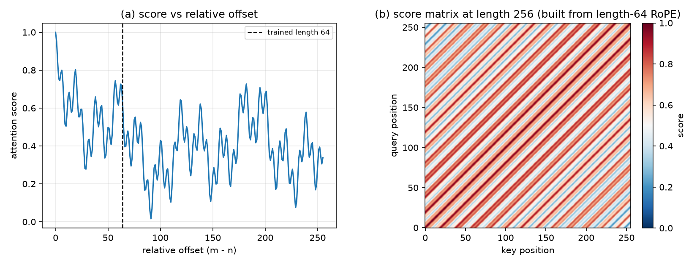
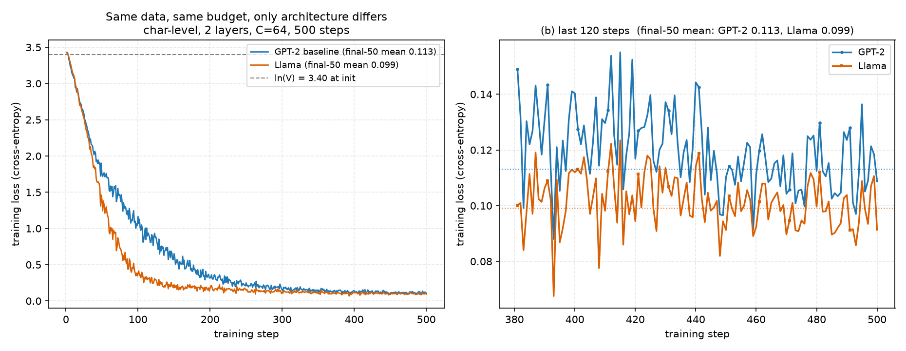

# 从 GPT-2 进阶到 Llama 架构（9 步）

2026-10-30 审查修订：主实现为 `step06_model.py`；真实权重实例为 **SmolLM2-135M**，
不是 Meta LLaMA-2/3 权重。修正内容及边界见 [REVIEW_FIXES.md](REVIEW_FIXES.md)。
`runs/`、`OUTPUT.md`、`figs/` 保留原实验历史，不因修订而改写。


这是 [`transformer_steps/`](../transformer_steps/README.md) 的姊妹篇。假设你已经读完那 8 步
（GPT-2 风格：字符分词、学习式位置嵌入、LayerNorm、GELU-FFN、MHA），现在把同一套骨架
一步步改成 Llama：每一步只改一个概念，每个文件都能单独运行，打印形状、自检结果和一句人话总结。

全部在 CPU 上跑：不用 GPU，不用联网（只有 step09 需要先下载一次约 260 MB 的真实权重）。
读完你应该能回答：Llama 到底改了 GPT-2 的哪几处、每处为什么改、改完参数/显存/速度怎么变。

## 0. 一页纸结论

| 步骤                    | 问题                                | 真实结论（数字来自 `runs/`）                                                              |
| ----------------------- | ----------------------------------- | ----------------------------------------------------------------------------------------- |
| 01 RMSNorm              | LayerNorm 要减均值、还要 γ 和 β     | 参数 64 vs 128（一半）；本例 gamma=1 时 RMS 约 1，输出未重新居中；玩具规模实测速度看不出优势    |
| 02 SwiGLU               | GELU 逐通道独立，没有门控           | hidden 170.67 → 176；FFN 参数 33,792 vs 32,768（+3.1%）                                   |
| 03 RoPE                 | 位置表占 T·C=4,096 个参数，超长越界 | 平移 +37 后分数最大差 4.11e-06；长度 256 照算（平均 0.812 vs 0.801）                      |
| 04 GQA                  | MHA 的 KV cache 每 token 存 2C 个数 | attn 12,288 vs 16,384（-25%）；toy cache 32,768 vs 65,536 B；8B/8k 上下文 1.0 vs 4.0 GiB  |
| 05 Block                | 四个零件散落在前面各步              | block 46,208 vs GPT-2 49,984（-7.6%）；attn/FFN/norm = 26.6% / 73.1% / 0.3%               |
| 06 MiniLlama + KV cache | 拼成完整模型；decode 每步重算整段   | 参数 96,320（共享 94,400）；8 步 max\|diff\| 1.19e-07；KV 512 B/token                     |
| 07 同预算训练           | 四个改造一起上到底值不值            | loss 0.1131 → 0.0990（-0.0141）；参数 -8.2%；KV 1,024 → 512 B/token                       |
| 08 HF 对齐              | 「能跑」不等于「写对」              | max\|diff\| 1.192e-07；三种常见错法 5.3e-03 / 6.3e-03 / 4.1e-01                           |
| 09 真实权重             | 自己的代码能不能吃官方权重          | 272 个张量 strict 加载、134,515,008 参数；logits 差 4.768e-05；top-5 与 12 token 贪心一致 |

三句话记住：

- 玩具规模（2 层、64 维、438 字符、500 步）上，Llama 的 loss 只低 0.0141，**不能外推**到真实模型。
- 参数几乎持平（104,960 → 96,320，-8.2%），真正省的是 KV cache：8B 规模、8k 上下文 1 GiB vs 同规模 MHA 4 GiB。
- 判断「写对没写对」不靠 loss 好看，靠 step08 的逐元素近似对齐：1.192e-07。

## 1. 怎么运行

在仓库根目录，用仓库自带的 `.venv`；单步跑：

```bash
.venv/bin/python llama_steps/step01_rmsnorm.py       # 02–08 同理
.venv/bin/python llama_steps/step09_real_llama.py    # 需要先下载权重
```

一键跑完用 `bash llama_steps/run_all.sh`（推荐）：它依次执行 01–09，把每个脚本的 stdout 原样存到
`llama_steps/runs/stepNN.txt`，并重新生成 `figs/` 里的两张图；`runs/` 就是 [`OUTPUT.md`](OUTPUT.md) 的来源。

环境：Apple M5 / macOS / CPU fp32，Python 3.14.3、torch 2.14.1，不用 GPU/MPS。9 个脚本全部跑完
约 15 秒（CPU，实测 14.0 秒；各步耗时表在 [`OUTPUT.md`](OUTPUT.md) 末尾），除 step09 下载权重外不需要联网。

step09 可选：没有权重时 `run_all.sh` 会打印 skip 并跳过，前 8 步照常跑。第一次先下载
（约 260 MB，已下载会自动跳过）：

```bash
.venv/bin/python llama_steps/download_llama_weights.py
```

## 2. 目录结构

```text
llama_steps/
├── README.md                  # 本文件：为什么改、改完什么样
├── OUTPUT.md                  # 九个脚本的真实 stdout 原文
├── step01_rmsnorm.py          # 1. LayerNorm → RMSNorm（不减均值、去掉 β）
├── step02_swiglu.py           # 2. GELU-FFN → SwiGLU（多一个门控矩阵）
├── step03_rope.py             # 3. 学习式位置嵌入 → RoPE（旋转 q/k，0 参数）
├── step04_gqa.py              # 4. MHA → GQA（多个 Q 头共享一组 K/V）
├── step05_block.py            # 5. 把四个零件拼成 Llama Block
├── step06_model.py            # 6. 完整 MiniLlama + KV cache
├── step07_train.py            # 7. GPT-2 vs Llama 同预算训练对照
├── step08_parity.py           # 8. 和 HuggingFace 逐元素近似对齐 + 改造清单
├── step09_real_llama.py       # 9. 装 SmolLM2-135M 真实权重并生成
├── run_all.sh                 # 一键跑 01–09，输出存 runs/
├── download_llama_weights.py  # 下载 SmolLM2-135M（约 260 MB，只需一次）
├── runs/step01.txt … step09.txt   # run_all.sh 保存的真实输出
├── figs/step03_rope.png       # RoPE 相对位置 / 256×256 外推示意图
├── figs/step07_loss.png       # GPT-2 vs Llama 训练 loss 曲线
└── weights/smollm2-135m/      # 本地权重，不进 git（见第 10 节）
```

根目录的 [`minimal_llama.py`](../minimal_llama.py) 是同一套东西的单文件压缩版（训练 + 生成 + KV cache）。

## 3. 九步都改了什么

| 步骤 | 文件                   | 新增概念                            | 关键形状 / 数字                   |
| ---- | ---------------------- | ----------------------------------- | --------------------------------- |
| 01   | `step01_rmsnorm.py`    | 归一化：LayerNorm → RMSNorm         | 参数 128 → 64；本例 gamma=1 时输出 RMS 约 1   |
| 02   | `step02_swiglu.py`     | 前馈：GELU → SwiGLU 门控            | C → 176 → C；33,792 vs 32,768     |
| 03   | `step03_rope.py`       | 位置：查表 → 旋转 q/k               | cos/sin (320,16)；平移差 4.11e-06 |
| 04   | `step04_gqa.py`        | 注意力：MHA → GQA                   | q (B,4,T,16)、k (B,2,T,16)；-25%  |
| 05   | `step05_block.py`      | 组装：RMSNorm + RoPE + GQA + SwiGLU | block 46,208 vs 49,984            |
| 06   | `step06_model.py`      | 完整模型 + KV cache                 | 96,320 参数；cache 32,768 B       |
| 07   | `step07_train.py`      | 训练对照：同数据、同预算            | loss 0.1131 vs 0.0990             |
| 08   | `step08_parity.py`     | 和 HF 逐元素近似对齐 + 三个反例           | max\|diff\| 1.192e-07             |
| 09   | `step09_real_llama.py` | 真实 SmolLM2-135M 权重              | 134,515,008 参数；差 4.768e-05    |



图 1：`figs/step03_rope.png`。左图 (a) 固定 query 与各位置 key 的分数随相对距离 |m-n| 变化，虚线标出参照长度 64（该图未训练模型）；
右图 (b) 用 cos/sin 现算的 256×256 分数矩阵，斜条纹说明分数只由 i-j 决定（Toeplitz 结构）；step03 把表建到 320 只为同时演示 256 和 +37 平移。



图 2：`figs/step07_loss.png`。左图两条训练 loss 曲线（同语料、同 batch、同 500 步，虚线是初始 ln(V)=3.40）；
右图放大最后 120 步，两条虚线是原实验最后 50 步均值：GPT-2 0.113、Llama 0.099。

## 4. GPT-2 → Llama 组件对照

| 组件        | GPT-2                                    | Llama                                    | 好处 / 代价                                                                               |
| ----------- | ---------------------------------------- | ---------------------------------------- | ----------------------------------------------------------------------------------------- |
| 归一化      | LayerNorm：γ + β = 2C 个参数，输出均值 0 | RMSNorm：只有 γ = C 个参数，输出经 gamma 缩放，RMS 不保证为 1 | 少一半参数、少一次减均值；代价：不再重新居中                                              |
| 前馈 FFN    | GELU，C→4C→C，8C² 个参数                 | SwiGLU，C→8/3C→C，3·C·F ≈ 8C²            | 门控决定哪些通道多传递（三个投影仍是 dense，实际 FLOPs 取决于 hidden 和实现）；代价：多一个矩阵、hidden 要取整 |
| 位置编码    | 学习式 wpe，一张 (block_size, C) 的查表  | RoPE：0 参数，按绝对位置旋转 q/k         | 公式可计算更远位置；代价：本实现需预计算 cos/sin 表，长上下文质量需另外验证                      |
| 注意力      | MHA：K/V 头数 = Q 头数，4C²              | GQA：K/V 头数 = Q 头数 / g，2C² + 2C²/g  | KV cache 小 g 倍；代价：K/V 表达能力被压缩                                                |
| Linear bias | 带 bias（toy block 里 9C = 576 个）      | 全部 `bias=False`                        | 少参数、便于算子融合；代价：失去一点平移自由度                                            |
| dropout     | 0.1                                      | 0.0                                      | 数据量大时收益低，还省一次 mask；代价：小数据上更容易过拟合                               |
| 输出层      | `lm_head` 与 `token_embedding` 共享      | 默认不共享（SmolLM2 等小模型仍共享）     | 多 V·C 个参数；代价：小模型可以共享省参数                                                 |

同样配置（V=30、C=64、2 层、4 个 Q 头 / 2 个 KV 头、F=176、block=64）下的参数量，step07 实测：

```text
item                           GPT-2     Llama     delta
token_embedding                1,920     1,920        +0
position_embedding             4,096         0    -4,096
lm_head                            0     1,920    +1,920
attention（2 层）             32,768    24,576    -8,192
ffn（2 层）                   65,536    67,584    +2,048
norm（2 层 + 最终）              640       320      -320
total                        104,960    96,320    -8,640
```

Llama 是 GPT-2 的 91.8%：attention 少 25%（4C² → 3C²），FFN 多 3.1%（SwiGLU 三个矩阵），
位置表换成 0 参数的 RoPE，lm_head 不再共享。KV cache 每 token 的字节数（K、V 各一份）：

```text
公式：2 · n_layer · n_kv_head · head_dim · sizeof(dtype)
toy 配置 fp32（2 层, D=16）：GPT-2 MHA(4 组 KV) 1,024 B/token | Llama GQA(2 组 KV) 512 B/token
toy 配置 fp16：               GPT-2 512 B/token             | Llama 256 B/token
Llama-3-8B fp16（32 层, 8 组 KV, D=128）：128 KiB/token，8192 上下文 = 1 GiB
同规模 MHA（32 组 KV）：                  512 KiB/token，8192 上下文 = 4 GiB
```

toy 模型整个 cache 是 32,768 B（512 B/token × 64 个位置），在 `step06_model.py` 里用 `KVCache.nbytes()` 实测。

## 5. 形状速查

```text
B   batch size
T   序列长度（<= block_size = 64）
C   n_embd = 64
H   n_head = 4（query 头数）
Kv  n_kv_head = 2（key/value 头数）
g   H / Kv = 2（每 g 个 Q 头共享一组 K/V）
D   head_dim = C / H = 16
V   vocab_size = 30（字符级）
F   ffn_hidden = 176（8/3·C 取整）
idx                 (B, T)
token_embedding     (B, T, C)              # 没有位置嵌入，位置信息在 RoPE 里
q                   (B, H, T, D)           # q_proj 后 view + transpose
k, v                (B, Kv, T, D)          # k_proj / v_proj 的输出，头数只有 H 的 1/g
repeat_kv(k)        (B, H, T, D)           # 复制 g 份和 q 对齐，不新增参数
scores              (B, H, T, T)           # q @ kᵀ / √D，再加因果掩码
attn out            (B, T, C)              # 各头拼回来，过 o_proj
logits              (B, T, V)
loss                ()
rope_cos, rope_sin  (block_size, D)        # 模型里的缓冲区，(64, 16)，不进 checkpoint
cos[start_pos:...]  (T, D)                 # decode 时按绝对位置切片
KV cache 每层 k/v   (B, Kv, block_size, D) # (1, 2, 64, 16)
KV cache 总字节     = 2 · n_layer · B · block_size · Kv · D · 4 = 32,768
```

step03 为了演示外推，把 cos/sin 表建到 320（`(320, 16)`），才能算 256×256 的分数矩阵；
真正的模型只建到 `block_size=64`，超过就抛 `ValueError`。

## 6. 每一步最该记住的一句话

1. **RMSNorm**：不减均值，按 RMS 缩放后乘可学习 gamma（含 eps，不保证输出 RMS=1），参数少一半。
2. **SwiGLU**：用 SiLU 门逐元素筛一遍通道，hidden 缩到 8/3·C 保住参数量。
3. **RoPE**：旋转 q/k 而不是加位置向量，0 参数，固定 q/k 内容的旋转点积体现相对位置，真实分数也取决于内容。
4. **GQA**：g 个 Q 头共享一组 K/V，cache 小 g 倍，参数少 25%（g=2）。
5. **Block**：骨架不变（Pre-Norm + 两条残差），只换零件，所以能叠深。
6. **MiniLlama**：没有位置嵌入、没有 bias、默认不共享权重；KV cache 存旋转后的 k。
7. **训练对照**：同预算下 Llama 参数更少、KV 更小；玩具 loss 差 0.014 别当真。
8. **HF 对齐**：在预先声明的容差内核对；1e-7 是本例观察值；写错会放大到 1e-3 以上。
9. **真实权重**：134M 参数加载后，再用 logits 与完整 token 序列验证当前实例；流畅英文不替代验证。

## 7. 动手改一改

1. **把 GQA 改成 MQA**：把 `LlamaConfig.n_kv_head` 从 2 改成 1。step04 会打印 `MQA (kv=1) = 10,240`；
   KV cache 每 token 从 512 B 降到 256 B，toy 总缓存 32,768 → 16,384 B。
2. **把 GQA 退回 MHA**：`n_kv_head = n_head = 4`。step04 的等价性自检仍然打印 `max|diff| = 0.0e+00`，
   但 attn 参数从 12,288 回到 16,384。
3. **写错 `repeat_kv`**：把 `repeat_interleave` 换成 `x.repeat(1, n_rep, 1, 1)`（整块复制），
   step08 的 `max|diff|` 会从 1.192e-07 变成 4.061e-01。
4. **写错 RoPE 配对**：把 half-split 换成 interleaved（相邻通道配对），step08 的 `max|diff|`
   会变成 6.281e-03；直接去掉 RoPE 是 5.323e-03。
5. **改 `rope_theta`**：从 10000 改成 1e6。step03 的 cos/sin 表和 256×256 分数矩阵照算，但每个
   位置转得更慢，`|offset| ≥ 64` 的平均分数会变——NTK/YaRN 那类外推缩放调的就是这个旋钮。
6. **缩短 `block_size`**：把 `LlamaConfig.block_size` 从 64 改成 32，再跑 step06：第 65 个 token
   会触发 `ValueError`，错误信息里的 `block_size 64` 变成 32（RoPE 表和 KV cache 一起变短）。
7. **把 RMSNorm 换成 LayerNorm**：在 `step06_model.py` 里让 RMSNorm 减去均值、除以标准差。
   step08 的对齐会立刻失败（HF 用的是 RMSNorm，断言阈值 1e-5），说明对齐检查能抓住这类错误。

## 8. 常见问题

### 为什么 Llama 去掉 bias？

去 bias 是 PaLM/Llama 的工程取舍：实践上质量基本不降，但每个 Linear 少一组 bias 参数、少一次加法，
也更容易把矩阵乘法和归一化融进一个 kernel。注意：不要理解成「RMSNorm 会消掉 bias」——RMSNorm 把
整条向量（包括偏移）一起缩放，并不会去掉它。step05 的对照：GPT-2 block 的 bias 共 9C = 576 个，Llama 是 0 个。

### 8/3·C 哪来的？

SwiGLU 有三个矩阵，参数是 3·C·F；要和 GPT-2 FFN 的 8C² 对齐，令 3CF = 8C²，解出 F = 8C/3 ≈ 2.67C。toy 里 C=64 → 170.67，
向上取到 8 的倍数得 176（step02 实测 33,792 vs 32,768，比值 1.0312）。真实模型取 256 的倍数：Llama-7B 的 C=4096，8/3·4096 = 10922.67，取整到 11008。

### RoPE 为什么能外推，学习式位置嵌入不能？

学习式位置嵌入是一张 `(block_size, C)` 的查表（step03 里表长 64）；位置 id 只能查表内的行，查位置 200 直接 `IndexError`。
RoPE 没有查表上限：cos/sin 由公式 cos(m·θ_i) 现算，θ_i = 10000^(-2i/D)，位置 id 多大都能算；step03 把表建到 320 只是为了同时演示
256 长度和 +37 平移。该公式图没有训练模型，其中 64 只是参照长度，不是已测训练长度；256×256 照算（0.812/0.801、保范数 4.77e-07），但能算 ≠ 效果好，远距离仍会退化。

### GQA 省显存，为什么参数只省 25%（g=2 时）？

因为 attention 只占 block 的一小部分：toy block 里 attn 26.6%、FFN 73.1%、norm 0.3%（step05）。GQA 只动 K/V 投影：
4C² → 2C² + 2C²/g，g=2 时是 3C²，少 25%（12,288 vs 16,384）；g=4 时是 2.5C²，少 37.5%。KV cache 才是重点：
每 token 的 KV 元素数与 n_kv_head 成正比，g=2 相对 MHA 直接减半（toy 65,536 → 32,768 B；Llama-3-8B 8k 上下文 4 GiB → 1 GiB）。

### 为什么 step07 的 loss 差距只有 0.014？

玩具规模太小：438 个字符、2 层、64 维、500 步（同预算 = 同训练 token 数，不是同参数量），两个模型都能背下这段语料，
loss 都压到 0.1 附近，架构差异被「记住语料」淹没。实测最后 50 步均值 0.1131 vs 0.0990（差 0.0141），
固定评测 batch 0.1107 vs 0.0996。该玩具结果的幅度很小，**不能外推**。GQA 的 KV 容量变化可以按公式核对，模型质量和运行速度需另测。

### 为什么 step08 的误差是 1e-7 而不是 0？

两边数学上等价，但浮点加法的顺序不同：HF 的 Linear/attention 走的是不同的 kernel 和累加顺序（还有融合算子），float32 每次运算都有舍入。
1.192e-07 是这个 fp32 实例的观察误差，满足预设容差，不代表逐位相同。作为对照：真的写错时误差会到 5.3e-03（去掉 RoPE）、
6.3e-03（interleaved 配对）、4.1e-01（repeat_kv 整块复制），差了 4 个数量级——所以 1e-5 的断言既能抓住错误，又不会误报。

### 为什么 step09 的 logits 差 4.8e-05，生成却完全一样？

30 层堆叠 + bf16 权重转 fp32，误差逐层累积，到 logits 是 1e-4 量级；但 top-5 token 一样、贪心 12 个 token 一样，说明误差没有改变排序。
温度采样（0.8 + top-k 40）本身有随机性，不能拿来对比两次实现。

### 为什么 step01 里 `nn.LayerNorm` 比手写 RMSNorm 还快？

因为 `nn.LayerNorm` 是单个 C++ 融合 kernel，而 RMSNorm 模块由几个小算子拼成；8×64×64 这种小张量上启动开销占大头。
step01 实测：手写 RMS 公式比手写 LN 公式快约 3 倍（少一次减均值），但融合版 LayerNorm 反而比 RMSNorm 模块快；
所以玩具规模上看不出 RMSNorm 的速度优势，省下的是「少一次逐元素计算 + 一半参数」，其他尺寸和实现下是否更快需另测。

## 9. 和 CS336 A1 的关系

2026 的 CS336 A1 要求写 Llama 风格的模型（BPE + RMSNorm + SwiGLU + RoPE + AdamW）。这套材料
覆盖除 BPE 外的全部前置（归一化、门控 FFN、RoPE、GQA/MHA、完整 LM、训练循环、逐元素近似对齐）；
BPE 分词器和训练工程是 A1 本身的内容，路线见 [`../CS336_A1_DETAILED_PLAN.md`](../CS336_A1_DETAILED_PLAN.md)。

## 10. 权重与许可

- step09 用 **HuggingFaceTB/SmolLM2-135M**（Apache-2.0）：30 层、576 维、9 个 Q 头配 3 个 KV 头、SwiGLU 1536、RoPE theta=100000、tied embedding。
- 大小：`model.safetensors` 约 257 MiB，整个目录约 260 MB。下载（只需一次，已下载会自动跳过）：
  `.venv/bin/python llama_steps/download_llama_weights.py`，存到 `llama_steps/weights/smollm2-135m/`。
- 没有权重时 `run_all.sh` 会跳过 step09，前 8 步照常跑；`step09_real_llama.py` 自己也会打印
  `[SKIP]` 和下载命令。
- **权重不要提交到 git**：约 260 MB 的二进制文件只应存在本地（把 `llama_steps/weights/` 写进 `.gitignore`）；下载脚本
  只拉 `config.json`、`model.safetensors`、`tokenizer.json`、`tokenizer_config.json`、`generation_config.json` 五个文件。


## 11. 当前解释边界

- 所有模型尺寸和权重共享设置来自各自配置。SmolLM2 真实回放、MiniLlama 玩具模型、Meta LLaMA-2/3 的配置对照分别标识，不混用层数、词表和运行数据。
- RoPE 相对位置性质针对固定 q/k 内容向量。实际注意力分数还依赖内容；相同内容铺满位置所得 Toeplitz 图仅是公式示例。图中的 64 是参照长度，该图并未训练模型。
- RoPE 公式可延伸不等于模型已经支持更长上下文。当前实现同时受预计算 RoPE 表和缓存容量限制；更长位置可计算也不证明质量良好。
- RMSNorm 不重新居中；eps 与可学习 gamma 会影响输出 RMS 和均值。SwiGLU 的 SiLU 门可为负或大于 1，不是概率或二值开关。
- step08 的 GPT-2 8k 行仅是容量公式外推，不是原 GPT-2 的可运行上下文。GQA 容量比例固定其他维度与 dtype 后才适用；不能推导真实加速或所有模型都会采用。
- step09 的生成循环计时排除 prefill，包含选词、拼接及循环内前向；末次可能算出未用于继续选词的 logits。上下文满时可选出最后一个 token，输出最多为 block_size+1，该 token 不再前向；平均耗时除以实际新 token 数。
- 小语料训练结果和通顺生成不能证明通用质量或架构优越性。数值比较是当前输入、权重、设备和精度下的验证，不承诺跨环境逐位相同。

修正回归检查（CPU，无训练、无下载）：

```bash
PYTHONDONTWRITEBYTECODE=1 HF_HUB_OFFLINE=1 TRANSFORMERS_OFFLINE=1 .venv/bin/python llama_steps/tests/test_review_regressions.py
```
